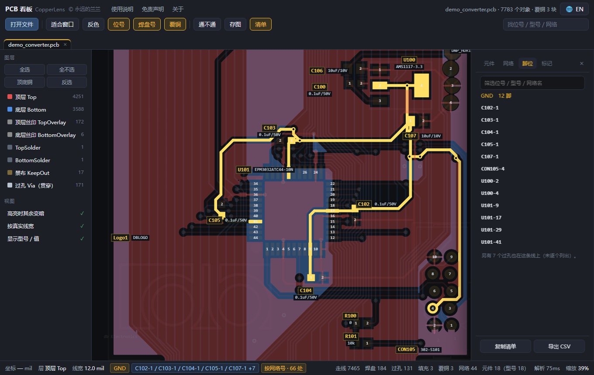
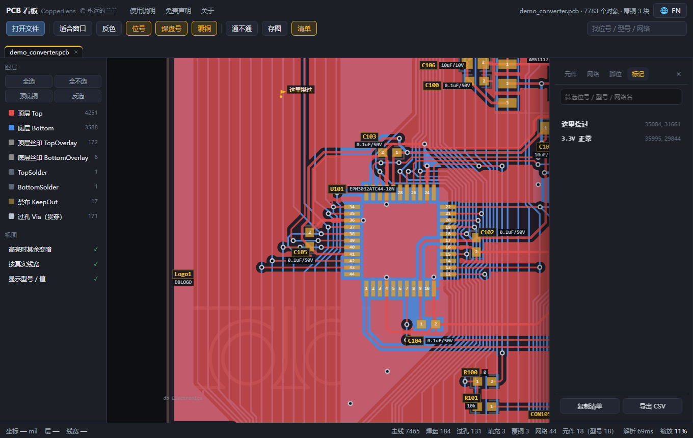
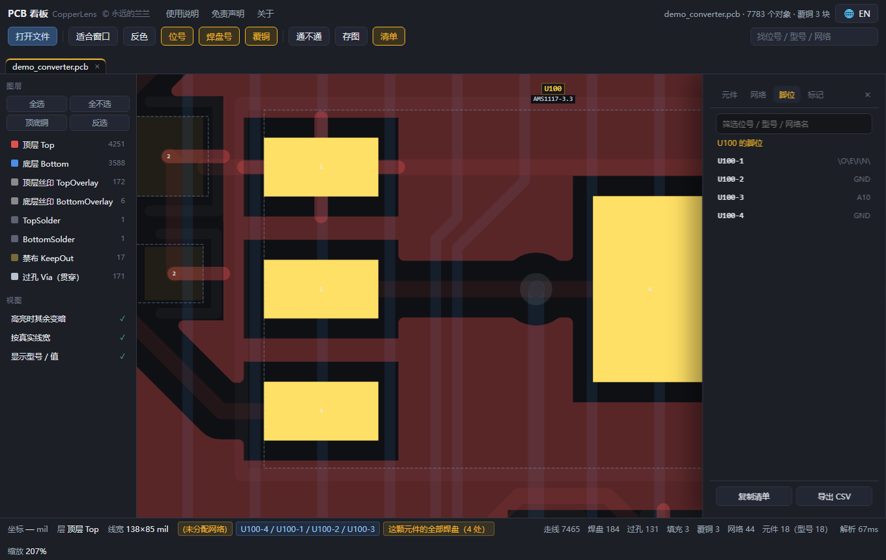
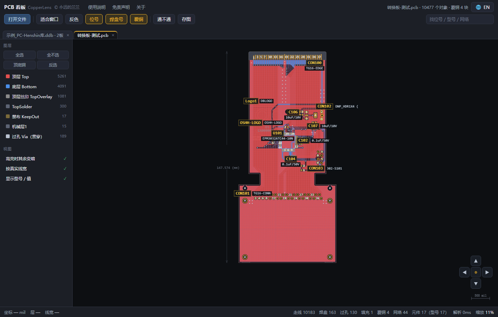
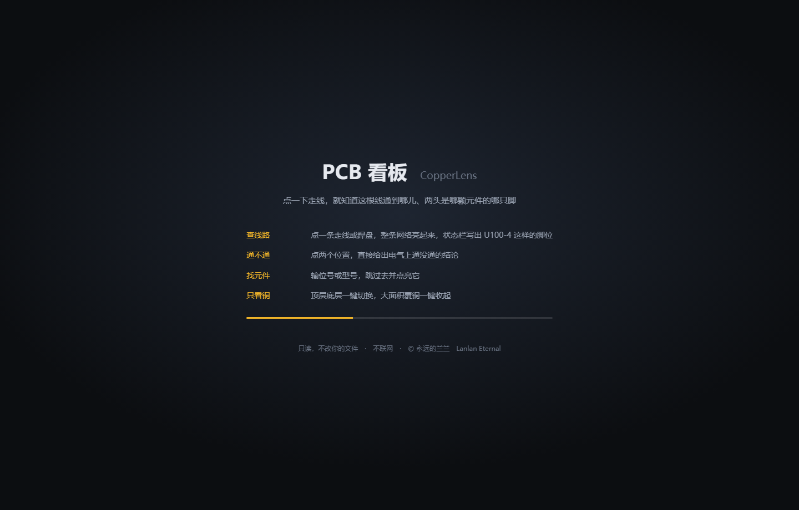

# 版本履历 / Changelog

PCB 看板 / CopperLens 的逐版改动记录。功能说明与用法见 [README](README.md)。

每节写的是「为什么这么改」而不只是「改了什么」—— 里面那些坑，下一个改这套代码的人
（很可能就是几个月后的我）会需要。

格式：`## vX.Y 改了什么`，新版本在上。

---

## v1.22 改了什么

**这一版读 Altium Designer 的 `.PcbDoc` —— 国内画板子用得最多的那个软件。**

跟前几版不一样，`.PcbDoc` 是**同一个后缀、两种完全不同的存法**：

| 存法 | 怎么来的 | 里面是什么 |
|---|---|---|
| 二进制（默认） | 平时的保存 | 一个 OLE2 / 复合文档（老 Office 那种"文件里的文件系统"） |
| ASCII | File → Save Copy As → PCB ASCII | 一行一条 `\|RECORD=Track\|…\|` 的纯文本 |

两条路要分别读，读到同一个出口。这一版把两条都通了。

### 一、先认清楚：`.PcbDoc` 和 `.ddb` 都是 CFB

复合文档开头那 8 个字节（`D0 CF 11 E0 A1 B1 1A E1`）是 CFB 的魔数，
`.PcbDoc` 有，**Protel 99SE 的 `.ddb` 也有** —— 后者其实是个 Jet 数据库，
一个文件里装着原理图、封装库和好几块板。只看魔数就认，会把整个设计库当成一块板画出来。

分得开的办法是**看里面的流名**：

- 有 `MSysObjects` → 是 `.ddb` 的数据库内核，不是单块板；
- 有 `Board6` / `Pads6` / `Tracks6`（老版本没有那个 `6`）→ 是板子。

这段判定在启动器和页面里各写一份，两边必须说同一句话，否则"能打开"和"打不开"
两个反应会打架。

### 二、二进制这一侧

复合文档里，板子的每一类对象各占一个子流，每个子流再挂 `Data`（记录本体）和
`Header`（记录条数，四字节，可以不理）：

```
Board6  Pads6  Tracks6  Vias6  Arcs6  Nets6  Components6
Texts6  Polygons6  Regions6  Fills6  WideStrings6
```

三个必须记住的约定：

- **坐标是 1/10000 mil**（2.54 nm），有符号 i32。Y 轴朝上，**不用翻**。
  一块 69 mm 的板子，坐标是 2700 万上下，看着像溢出，其实没坏。
- **属性串**是 `u32 长度` + `|键=值|键=值|`。长度的**最高字节**如果非 0，
  那一位是"这是一段二进制块"的标志，得先抹掉再当长度用；末尾的 NUL 算在长度里。
- **记录**是 `1 字节类型` + 若干"子记录"，每个子记录前面一个 u32 长度。
  子记录条数按类型固定：焊盘 6 条、过孔 1 条、走线 1 条、文字 2 条。

走线的子记录布局（**这一段踩得最狠**）：

```
layer(u8) flags1 flags2 net(u16) polygon(u16) comp(u16) skip4
start(2×i32) end(2×i32) width(i32) subpolyindex(u16) skip1
unionindex(u32) skip1 layer_v7(u32) keepout(u8)
```

`width` 后面那两个字段（子多边形序号 + 一个字节）如果不读，后面那个"新式层号"
就会读到别的地方去 —— 表现是**整块板的线全落到 56 层**（板框层），一片金色。
补上 `u16` + `skip(1)` 之后，一块 9 MB 的板从"48 条线"变成 7439 条，层分布才合理。

`Regions6`（新版 Altium 把浇出来的铜存成 Region，不再是一堆小线段）也栽过一次：
头部是 `layer(u8) flags flags net(u16) poly(u16) comp(u16) skip5 holecount(u16) skip2`，
属性串从第 18 字节起，之后是 `顶点数(u32)` + 每点 16 字节的 `f64 x, f64 y`。
`skip 5` 写成 `skip 4` 的话，532 条里没有一条能对齐。现在的验收标准是
**每条解析完的游标正好等于记录长度**，532/532。

### 三、层号有三套，别混着用

| 出现在哪 | 长什么样 | 含义 |
|---|---|---|
| 老字段（第一个字节） | 1..74 | Altium 的老层号：1 顶、2..31 内层、32 底、33/34 丝印、39..54 内电层、56 禁布、57..72 机械 1..16、74 多层 |
| V7 字段 | `0x01000000 + n` | n 是**第几层铜**（1 起算），不是老层号 |
| V8 字段 | `0x01030000 + n` | 同上那一套的另一批编号 |

V7/V8 里还有 `0x01020000 + n`，那是**机械 n**（`0x0102000D` = 机械 13）。
机械层除了机械 1（多数板的板框在这层，本程序把它并到 56 层）之外一律不画 ——
装配图、尺寸标注、拼板 V 割、3D 外形，一块板子上常有几千条，全画出来就是一锅粥。

### 四、层名要用设计者自己起的那串

`Board6` 里有 `LAYER<n>NAME` 和 `LAYER<n>NEXT`。`NEXT` 把在用的铜层串成一条链
（`1 → 2 → 3 → … → 32`），链外的那些名字往往是"MidLayer11"这种默认值，
甚至是从别的工程拷过来的旧名 —— LimeSDR 的 `LAYER11NAME` 也叫 `L7`，
照抄就会出现两个 `L7`。

所以只抄**层叠链上**那些。LimeSDR 于是显示成 `Top / L2 / L3 / L4 / L5 / L6 / L7 / Bottom`，
跟 Altium 图层面板里一模一样，而不是 `MidLayer2` 到 `MidLayer30`。

### 五、Board 记录里那圈顶点，经常不是板框

这一条是本版最反直觉的：`Board` 记录里那串 `VX/VY/KIND` 顶点，**很多时候画的是
设计图纸的外框，不是板子**。Open433 那块板，Board 记录给的是 5660 × 5419 mil
（一张大图纸），真正的板框画在 Keep-Out 层上，只有 1636 × 800 mil。
照 Board 记录画，屏幕上就是一个空荡荡的大方框套着一小块板 —— 比不画更糟。

现在的规矩：

1. 文件里已经有 56 层的线（Keep-Out 那圈 / 机械 1 那圈）→ 那就是真板框，Board 记录不画；
2. 一条 56 层线都没有 → 才用 Board 记录兜底，但先拿铜皮的大小量一量，
   大出三倍以上就认定它是图纸，也不画。

### 六、ASCII 这一侧：位号得自己认

ASCII 版把位号画成一条独立的 `Text`，**不跟元件绑**（二进制版有 `+301=1` /
`+300=1` 两个标志位，一眼就知道哪条是位号、哪条是型号）。所以：

- 文字正文在 `WIDESTRING=79,112,101,110` 里，是**字符码逗号串**，得逐个转回来；
- 位号靠"离这颗元件最近、长得像位号（`R7` / `U12` / `C103`）、在丝印层上"认领，
  阈值 400 mil。认不回来的就留空，不硬凑。

### 七、验证

| 样例 | 结果 |
|---|---|
| 二进制 · 只有板框的空板（152 KB） | 板框 4 条、60 × 40 英寸、四角对得上 |
| 二进制 · LimeSDR-Mini v1.0（9 MB，7 层铜） | 焊盘 1644、走线 7439、过孔 778、圆弧 219、覆铜 280、文字 795、元件 371、网络 281；解析 144 ms |
| 二进制 · AltiumDesigner 模板板 | 焊盘 6、走线 2、圆弧 4，没有崩溃 |
| ASCII · Open433 | 焊盘 112、走线 449、过孔 43、圆弧 62、覆铜 8、元件 30、网络 48，外形 44.1 × 20.3 mm |
| ASCII · ESP32CTRL | 焊盘 140、走线 373、覆铜 170、元件 27、网络 21 |
| 负例 | Protel `.pcb` / KiCad `.kicad_pcb` / Eagle `.brd` / PADS `.asc` 一个都没被抢走；`.ddb` 靠 `MSysObjects` 挡住 |

页面侧断言 71 项、真机冒烟 11 个场景，全过。LimeSDR 那块板的层名、位号（`C183` 配
`100pF, 50V`）、焊盘网络（`NetC11_2`）、覆铜面积（3.34 平方英寸）都逐项对过。

### 八、补上预览图的署名（同日修订）

v1.22 的预览图换成了 LimeSDR-Mini —— 一块 8 层铜的开源 SDR 板，正好用来说明
多层板与层名。但这一换带出个疏漏：它的硬件设计是 **CC BY 3.0**，许可条件只有
一条「署名」，而 `第三方组件与许可.txt` 当时只列了 PC-Henshin（CERN-OHL v1.2）
和立创·泰山派（CC BY-NC-SA 4.0），漏了这一个。

已补：

| 来源 | 许可 | 出现在哪 |
|---|---|---|
| PC-Henshin | CERN-OHL v1.2 | 早期预览图 |
| 立创·泰山派 1F | CC BY-NC-SA 4.0 | `预览_立创.png` |
| **LimeSDR-Mini**（© Myriad RF / Lime Microsystems） | **CC BY 3.0** | `预览_Altium.png`、短片 |
| **KiCad 官方 QA 测试数据** | GPL-2.0-or-later | `预览_PADS.png`、短片 |

顺带把 PADS 那张的出处也讲清楚了：用的是 KiCad 源码树里的回归测试数据，
**不是任何客户的板子、也不是维修资料里取的**。这一点以前只在测试脚本的
注释里写过（`_t/t_pads_kind.py` 那句「KiCad QA 板」），对外没交代。

CC BY 3.0 比 CERN-OHL 宽松，只要求署名，不限制商用和修改。但按协议惯例，
除了署名还应注明「是否改动」与「不暗示原作者背书」——三条都写进了
`第三方组件与许可.txt` 第 2 节。

> 这次只改了 `第三方组件与许可.txt` 与 `README.md`，**没碰 `index.html`，
> 所以不需要重打 exe** —— 程序「关于」页里那句简版说明本来就只提 mdbtools。

### 九、仍然不做的

- **Cadence Allegro 的二进制 `.brd`**、**GenCAD**：还没有；
- **Altium 的 `.SchDoc` / `.PcbLib` / `.IntLib`**：是原理图和封装库，不是板子；
- **`.OutJob` / `.PcbDoc` 里内嵌的 3D 模型**：只算查看，不展开模型；
- **加密 / 加壳的板文件**（维修圈的 `.fz` 等）：要厂商密钥，做不到。

---

## v1.21 改了什么

**这一版读 PADS 的 `.asc` —— Mentor / Siemens PADS（Layout、PowerPCB）导出的 ASCII 板文件。**

PADS 在国内中小板和消费电子厂里很多，落到维修台上常常只有一份 `.asc`。
它和 `.kicad_pcb` 一样是纯文本，但格式是**分段式**的：一段一块内容，段名用 `*名字*`
括起来。读通它等于把「PADS 的板」也纳进同一个界面 —— 网络名、位号、脚号都是文件里
写着的，不用靠几何去猜。

### 一、一个扩展名，三种东西

`.asc` 不专属于板文件。同一份导出选项里还能勾出网络表和原理图，三者都是 `.asc`：

| 第一行 | 是什么 | 怎么办 |
|---|---|---|
| `!PADS-<产品>-V<版本>-<单位>!` | 板文件 | 正常打开 |
| `*PADS-PCB*` | 网络表 | 明说"只有连接关系"，教用户重导 |
| `*PADS-LOGIC*` / `*PADS-POWERLOGIC*` | 原理图 | 明说"不是板文件"，教用户重导 |

还有一种容易踩的：**文件头是板文件的 `!PADS-`，但里面只有 `*PART*` + `*CONNECTION*`
+ `*SIGNAL*`** —— 那是导出时只勾了网络表，没有几何段。这种如果当板子打开，用户看到的是
"解析成功但一片空白"，比直接报错更让人摸不着头脑。所以判定改成：**有几何段
（`*ROUTE*` `*LINES*` `*POUR*` `*BOARD*` `*PARTDECAL*` `*VIA*` `*TEXT*`）才算板文件**，
否则按网络表劝退。桌面版和页面版用的是同一条判定。

### 二、段名后面会跟说明文字

```
*ROUTE*      ROUTING ITEMS
```
所以不能用"这一行以 `*` 结尾"来判断段，得用 `^\*([A-Za-z][A-Za-z0-9_]*)\*` 取第一段。
这条踩过一次：一开始按"以 * 结尾"匹配，结果整份文件的段全被当成正文吃掉。

### 三、单位有四种，Y 轴不用翻

`MILS` / `INCH` / `MM` / **`BASIC`**。BASIC 是 PADS 的内部单位，1/38100 英寸
（38100 个单位 = 1 mil）。老工程（`V2005.0-BASIC`）导出的坐标动辄上千万，
看着像坏了，其实除以 38100 就是 mil。

Y 轴朝上，跟本程序的画布方向一致，**不用翻**。这点和 Protel、KiCad 都不一样，
抄它们的翻转换算会把板子上下颠倒。

### 四、三个不写就画错的地方

- **层 0 是飞线，层 65 是"接到脚上"**。顶点行 `x y 层 线宽 标志 …` 里的层号，
  0 表示还没布的飞线、65 表示这根线到此为止接上元件脚。两个都不是真铜，
  照画会多出一堆鬼线。现在 0 直接丢、65 只用来和焊盘对位。
- **弧不给圆心**。顶点行只带 `CW` / `CCW` 标志，而**带标志的那个点就是圆心**，
  弧从前一个点弧到后一个点。半径靠前一点到圆心的距离算。
- **线表的弧角点是八个数**：`x y 起始角×10 扫角×10 包围盒四角`。圆心 = 包围盒中点，
  半径 = 半个宽。当普通点读会让板框出现跨半块板的长弦 —— 上一版就是这样，
  板框上多了几条斜穿全板的直线。

### 五、覆铜的两处修正

- **`CIRCLE` 类的两个角点是"直径的两端"**，不是圆心和半径。按两点连线画，
  板上会多出一条横贯的直线，圆反倒没了。现在展开成 48 边形。
- **`*POUR*` 的块头比线表多一格**：`PIECETYPE CORNERS **ARCS** WIDTH LEVEL`。
  少认这一格，弧数会被当成线宽、优先级会被当成层号；更要紧的是，文件头声明
  "有几条弧"意味着**弧心行是插在端点前面的额外一行**（`cx cy 起始角 扫角`），
  不认它就会把圆心当成一个顶点，圆角覆铜画出来是穿过圆心的折线。
  判定方式：总行数 = `CORNERS + ARCS`，读到四元数行就当弧心，下一行才是端点。

### 六、非铜层号不能写死

同一个 22 号，在老工程里是"丝印顶层"，在新工程里是"钢网底层"。
所以优先读 `*MISC*` 里的 `LAYER DATA { LAYER n { LAYER_NAME … LAYER_TYPE … } }`，
按类型（`SILK` / `SOLDER_MASK` / `PASTE_MASK` / `ASSEMBLY` / `DRILL`）落到本程序的层，
读不到才退回"22/25 丝印、23/26 阻焊、24/27 钢网"这套最常见的编号。

这里有个顺序坑：**`*MISC*` 在真文件里几乎总排在最后**，而焊盘栈在解析封装时就要用
层号。好在焊盘是全部段读完才落到板上的（要等 `*PART*` 和 `*NET*` 齐了才能对网络），
所以 `*MISC*` 虽然后读，用的时候已经在了。

### 七、位号按封装自己给的位置放

封装里的文字记录是"属性行 + 字体行 + 内容行"，内容行写 `Part Type` 或 `Ref.Des.`，
属性行带 `dx dy 角度 层 字高`。照它放，位号就在原厂摆的地方；
不照它放（早期版本按元件中心 ±28 mil 硬放），位号会糊成一坨压在焊盘上。

### 八、首屏取景按板框

PADS 的图框、图例（"TOP COPPER" 这类字）常甩在离板子很远的地方，整份 bounds 能有
板子的四倍大，一打开板子只占屏幕两成。现在解析器自己算一个 `fitBounds`（板框外扩 4%），
`fit()` 优先用它 —— 只有板子只占图纸一小块时才生效，正常板子行为不变。

### 九、验证

| 样例 | 结果 |
|---|---|
| 真实双层板（`V2005.0`，BASIC 单位，全段齐全） | 焊盘 74、走线 1828（含 4 个整圆展开）、过孔 24、元件 30、网络 14、覆铜 3 |
| 焊盘栈专项（阻焊/钢网/通孔） | `U1` 落在 `[1,35,37]`、`U4` 落在 `[1,32,37,38]`、尺寸 0 的钢网不画 |
| 弧专项 | 90° 覆铜弧拆成 18 点、半径 1000 mil 不变；八数角点不再出跨板长弦 |
| 负例 | KiCad / Eagle / Gerber / Protel 都不被认成 PADS；网络表和原理图被明确拒绝 |

页面版那侧的断言 60 项、桌面版嗅探 20 项，都是零失败。

### 十、这一版仍然不做

- 不写文件，任何格式都只读。
- 不识别 PADS 的 `.pcb`（二进制）—— 那要另一套二进制布局知识。
- 库文件（`*.p` / `*.ld9`）里的封装不单独读：`.asc` 自己带 `*PARTDECAL*` 时才能画封装外框。

---

## v1.20 改了什么

**这一版读 ODB++ —— 板厂给的那包制造数据。**

它和 Gerber 是同一件事的两种做法，区别就一句话：**Gerber 只有图形，ODB++ 带网络名。**
所以在 Gerber 上"点一颗焊盘想知道这是哪个网络"是做不到的（只能靠几何连通性去猜），
而在 ODB++ 上这件事本来就是文件里写着的。

### 一、包里有什么

ODB++ 不是"一层一个文件"，而是一棵目录树，压成 zip（或老派的 `.tgz`）交出去：

```
matrix/matrix                              层清单：哪层是铜、哪层在上、行号怎么排
steps/<板名>/layers/<层>/features           每层的几何
steps/<板名>/layers/comp_+_top/components   位号 + 每个脚的坐标 + 网络号
steps/<板名>/netlist/cadnet                 网络号 → 网络名
steps/<板名>/layers/drill/features          钻孔
```

`features` 是逐行记录，空格分隔，分号后面挂属性：

| 记录 | 含义 | 字段 |
|---|---|---|
| `P` | 焊盘 | `x y 符号 极性 dcode 角度` |
| `L` | 线 | `x1 y1 x2 y2 宽度符号 极性 dcode` |
| `A` | 弧 | `起点 终点 圆心 符号 极性 dcode 顺逆` |
| `T` | 文字 | `x y 字库 极性 角度 宽 高 '内容'` |
| `S` … `SE` | 面积 | 中间夹 `OB`（轮廓起）/ `OS`（直线到）/ `OC`（弧到）/ `OE`（轮廓止） |

符号表就在同一个文件里：`$3 r55` = 3 号圆盘直径 55，`$5 oval24x74` = 椭圆。
**每个 features 文件都有自己的符号表**，没有全局表。

### 二、两个坑

- **单位**：坐标跟文件头 `UNITS=INCH|MM` 走，符号却可能自带 `I` / `M` 后缀，
  而英制符号常用 mil、公制符号常用 micro —— 于是 `r6` 可能是 6 mil、`r150` 可能是
  0.15 mm。做法是先按声明换算，再过量级体检：落在 1~600 mil 之外就换个解释重算，
  取第一个说得通的。
- **网络不在铜层里**：铜层的 P / L / A 记录一个网络名都没有。网络在
  `components` 的 `TOP` 记录（每个脚的坐标 + 网络号）和 `netlist` 的 `$` 表
  （编号 → 名字）里，两边**按坐标对号**才落到焊盘上。这也是断言里最看重的一条。

### 三、三种到手方式都认

| 形态 | 说明 |
|---|---|
| `.zip` | 最常见 |
| `.tgz` / `.tar.gz` / `.tar` | 老派打包，`matrix/` 常在包内一层目录下 |
| 一个**目录** | 用户自己把包解开之后，直接把那个文件夹拖到图标上也行 |

包里的文件不是全读：只挑 `matrix` / `features` / `components` / `netlist` / 钻层
那几类，其余（`fonts` / `misc` / `user`）不占内存。

### 四、层号怎么对

matrix 只告诉我们"这层是 SIGNAL 还是 SILK_SCREEN"，本程序内部仍用 Protel 那套编号：

- 铜层：最上面 = 1、最下面 = 32、中间依次 39、40…（层名原样显示成 `顶层 · top`）
- 丝印 33/34、钢网 35/36、阻焊 37/38、板框 56
- 钻孔层不当层看，而是回填成焊盘的孔 + 单独的过孔

matrix 里缺 LAYER 块（有些导出真的省了）时，按目录名自己认：
`top` / `bot` / `in1` 是铜，`sst` `ssb` `smt` `smb` 是丝印和阻焊 —— 这套三字母叫法
最容易和铜层混，单独做了排除。

### 五、验证

- 三份包描述同一块 2000×1200 mil 的板：英寸、毫米（符号带 `M`）、以及**把树套在
  `jobname/odb/` 下且 matrix 不写 LAYER** —— 三份读出来的焊盘 / 过孔 / 网络 / 板框
  必须完全一致，探针 70 项断言；
- 网络回填单独立了断言：`(330,600)` 上的焊盘必须叫 GND，`U1-2` 必须叫 VCC，
  底层的同名通孔焊盘也要跟着拿到 GND，而**阻焊层上的同名焊盘不算**；
- 不误判：Gerber 一包、几个随便的文件都不能被当成 ODB++；
- 真浏览器截图 + 真机冒烟 15 个场景（新增 zip / tgz / 目录 / 毫米包四个）。

### 六、这一版仍不做的

- 面积里的**洞**（`H` 轮廓）和**负极性的面**：不挖空，只画岛。板厂拿到的 ODB++
  大面积铺铜常常是"正片挖洞"，显示上会显得偏满，但查线不受影响；
- `eda/data` 里的器件封装定义（`PKG` / `PIN`）：位号和型号已经从 `components` 拿到了，
  没必要再读一遍；
- XZZ 加密 `.pcb`、华硕加密 `.fz`、Cadence Allegro 二进制 —— 要厂商密钥，做不到。

---

## v1.19 改了什么

**这一版加的是维修现场真正天天在用的那一族：点位图（BoardView）。**
v1.18 之前，我们能读的都是"工程师的板文件"；可手机、笔记本主板维修的师傅手里
根本没有设计工程，只有点位图 —— 而这恰恰是我们最该擅长的那类数据。

### 一、点位图：五种来源，一次补齐

点位图不存铜箔，只存**位号、焊盘坐标、网络名、板框**。这四样正好是我们查线、
找脚、测点、孔表全部功能所依赖的，缺的只是一个能读进来的解析器。

| 来源 | 认法 | 坐标单位 |
|---|---|---|
| `BVRAW_FORMAT_3` | 纯文本，一行一个 KEY VALUE | mil |
| `BVRAW_FORMAT_1` | 制表符分隔，`<<Layout>>` / `<<Pin>>` / `<<Nail>>` 三段 | 英寸 |
| BDV | `<<format.asc>>` / `<<pins.asc>>` / `<<nails.asc>>` 三段 | 英寸 |
| BRD（Landrex / TestLink） | `str_length:` / `var_data:` / `Format:` / `Parts:` / `Pins:` / `Nails:` 六段 | mil |
| CAD | `COMP` / `C_PIN` / `NET` / `N_VIA` 四段 | 英寸 |

三种扩展名（`.bvr` `.bv` `.bdv`）加 `.cad`，内容相同只是写法不同。

### 二、两种是混淆过的

- **BDV**：每行一个滚动密钥，从 `0xA0` 起、每遇到一个 `\r\n` 加 1、超过 285 归 159，
  非换行字节做 `key - byte`。加解密是同一个式子，所以解开和编回去都只用一段代码。
- **BRD**：整篇按字节做 `~(((c>>6)&3) | (c<<2))` —— 本质是**循环左移 2 位再取反**。
  开头的魔数 `23 E2 63 28` 是明文 `str_` 被变换后的样子，正好当识别标志。

写样例时我按反函数生成，再解回来核对，魔数自动对上了 `23 E2 63 28`，
两侧互逆性等于顺手验过一遍。

### 三、`.brd` 这个扩展名现在有三家

| 谁 | 内容 | 本程序 |
|---|---|---|
| Eagle（Autodesk / Fusion 360） | XML | 支持（v1.18） |
| Landrex / TestLink 点位图 | 六段文本（可能混淆） | **支持**（本版） |
| Cadence Allegro | 二进制 | 读不了，但会说明白 |

以前非 Eagle 的 `.brd` 只会弹一句"不是 Eagle 板文件"，现在先按内容分三路，
真读不了才报错，而且把三家的区别写清楚。

### 四、验证方式

- **合成样例对账**：五份样例描述同一块 2000×1200 mil 的板（3 个元件 / 8 个焊盘 /
  5 条网络 / 2 个测试点），五种格式读出来的数字必须完全一致 —— 差一个就说明某个
  分支漏了。探针 84 项断言。
- **互逆验证**：混淆格式的编码版与明文版逐项对比（焊盘数、网络名、坐标）。
- **不误判**：Eagle 的 `.brd`、KiCad、Gerber、Protel `.pcb`、随机二进制都不能被
  当成点位图。
- 真浏览器截图核验：板框、焊盘、位号、点亮 GND（4 处 / R1-2 · C1-2 · U1-3）。

### 五、仍然不做的

- **XZZ（鑫智造）的加密 `.pcb`、ASUS 的加密 `.fz`**：要厂商密钥，技术上做不到，
  法律上也不该碰；
- **ODB++**：还是只认得出、不解析（见 v1.18 说明）。

---

## v1.18 改了什么

**这一版加了第六种文件格式：Eagle 的 `.brd`。** 顺手把两件"一直看着别扭、但没空动"
的事一起修了 —— 内层不再一律紫色、覆铜浓度按片数自适应。

### 一、Eagle（.brd）

Autodesk Eagle（现在叫 Fusion 360 Electronics）在创客和小批量里用得很多，
GitHub 上相当一部分开源硬件是它画的。`.brd` 是纯文本 XML，跟前面几种比，
有四处必须翻译，不然画出来是歪的：

| 坑 | 说明 |
|---|---|
| 单位是 mm | 内部一律 mil，进来先乘 39.37 |
| **底层是 16，不是 2** | 2~15 全是内层。照 1/2 处理，四层板的内层会叠到顶层上 |
| 焊盘尺寸不在元件身上 | 元件只写"用哪个库的哪个封装、放哪儿、转了多少度"，尺寸在 `<libraries>` 里，得逐个实例化 |
| 网络另写在 `<signals>` 里 | `contactref` 指明哪只脚属于哪条网，焊盘本身不带网络 —— 先扫一遍建表，回头补 |

还有两个细节：`<wire curve="90">` 是弧（圆角板框、圆弧走线全靠它，弦长 + 圆心角
反算圆心），`rot="MR90"` 的元件要翻到底面、层号跟着翻（1↔16、tPlace↔bPlace），
不然底面元件的丝印会印在顶面上。

覆铜只按外轮廓画 —— Eagle 的真实铺铜是它自己算的（要避让、要留 isolate），
我们拿不到那份结果，跟立创专业版的处理方式保持一致。

**验收**：5 块真板子（Eagle 6.5 / 8.6 / 9.5 / 9.6）+ 1 块合成板，焊盘数、过孔数、
网络数与 Python 用 ElementTree 独立解析的结果逐一对齐；合成板专门覆盖真板子没走到的
路径（内层铜、镜像元件、方形通孔焊盘、圆弧走线）。共 122 项断言。

pyboard 实测：249 个焊盘全部认出位号，GND 一条网络点亮 45 脚 + 12 过孔，
状态栏直接写出 `IC1-12 / C1-1 / C10-2 …`。

### 二、内层不再一律紫色

四层板有两个内层、六层板有四个，全给一个颜色就分不清哪条线走哪一层 ——
"这条线在第几层"是维修时很实际的问题。改成按序号循环取色，冷暖交替，相邻两层差得开。

顺带把文件里给内层起的名字接进了图层面板：Eagle 的内层叫 GND / PWR 的，
现在显示成"内层 1 · GND"，而不是干巴巴的"内层 1"。

### 三、覆铜浓度按片数自适应

这是上一版留下的坑：立创专业版的一块覆铜会拆成上千片，每片哪怕只有百分之几，
叠起来也是实心色，所以浓度压到了 0.028；但 Eagle 一块 GND 平面就是一整片轮廓，
同样 0.028 在深色底上几乎看不见 —— 打开板子还以为覆铜没画出来。

现在按本层片数分三档：≤6 片用 0.20、≤80 片用 0.075、更多才回到 0.028。
立创那种几千片的板子观感一点没变。

### 四、ODB++ 还是没进

上次说的"比较难的两个"，Eagle 这版做完了，ODB++ 没做。原因很实在：
**ODB++ 是板厂给的制造数据，开源样例极少，拿不到可信样本就只能盲写** ——
盲写的解析器在真文件上必然出岔子，那比不做更坏。

能做的先做了：拖进 ODB++ 的包（`.tgz` / `.zip`，里面有 `matrix/matrix` 和 `steps/`）
时，现在会明确告诉你"这是 ODB++、本程序还不读、该跟对方要什么格式"，
而不是弹一句"只认 Gerber"。桌面版和在线版都认这个包。

---

## v1.17 改了什么

**这一版没有新增文件格式，全是"把手上这块板讲清楚"的工具。** 网格、孔表、A4 出图、
测点清单 —— 四样都不是看图的锦上添花，而是维修台上和打样报价单上真要交出去的东西。

### 一、定位网格 A1~H8

顶栏「网格」或 <kbd>G</kbd>：板面按行列切块，**列是数字**（从左往右 1、2、3…）、
**行是字母**（从上往下 A、B、C…），于是"E5 那颗 1uF"成了一句对方照着屏幕也找得到的话。

行列数按长宽比自动算：长边约 10 mm 一格，夹在 5~14 之间，短边按比例。
30 mm 的小板子给 5×5，69.6×30.0 mm 的泰山派核心板给 7 列 × 3 行（一格 9.9×10.0 mm）。
坐标字贴在板框外侧；板框被拖出画布时改贴画布边 —— 放大钻在板子中间时，
至少还知道自己在第几列。

画的是一条合并 path，开/关的重绘代价实测 168 ms vs 169 ms，在噪声里。

### 二、孔表：打样报价按孔型算钱

「清单 → 孔表」：**全板所有要下钻头的孔按孔径归堆**（过孔 + 插件脚；贴片焊盘没有孔，
天然不在里面）。一行写孔径 mil / mm、过孔数、焊盘数、合计；点一行 → 这个孔径的孔全亮，
并飞到它们的包围盒上。可复制、可导出 CSV。

按 1 mil 归组是必须的：同一个钻头在不同封装里会写成 31.5 和 32.0，不归堆就冒出一堆
只差 0.5 mil 的重复行，看着像这块板有几十种孔型。泰山派实测 1 种 / 1078 孔（8 mil），
demo_converter 5 种 / 171 孔。

### 三、A4 出图：先看纸、再打印

顶栏「打印」先给一张 A4 预览：白底、板子铺满、上面一行板名和尺寸、下面一行出图信息；
看着满意再点「打印…」，进打印机或者「另存为 PDF」都行。板子是横的就自动横向出纸。

三个具体做法值得记下来：

- **纸的高度写死 296 mm**（比 297 少 1 mm，Chrome 会为一毫米的舍入多吐一张空白页），
  图装在 `flex:1;min-height:0` 的盒子里、自己 `max-height:100%` —— 高度不确定的父级里
  `max-height:100%` 算不出来，图会溢出纸面。
- **`@page` 的方向要动态换**：CSS 里写不了条件分支，所以换成给 `<style id="pgStyle">`
  重写 `textContent`。
- **超采样出图**：临时把 `devicePixelRatio` 乘上一个倍数（`pxScale`），`resize()` 里
  `ctx.setTransform(dpr*pxScale,…)`，坐标仍按 CSS 像素走，别的绘制代码一行不用改。
  抓完复原并重画。2400 px 长边 → 约 330 dpi；从 326×666 提到 1401×2758，代价 353 ms。

白底是临时 `invert=true; draw(); toDataURL(); invert=wasInvert`：全程在同一个同步块里，
浏览器来不及重绘，屏幕不会闪一下白。

### 四、测点：每条线在哪儿下探头

「清单 → 测点」：**每条网络只给一处最好下探头的点**。判据是"探头尖能不能落住"：
短边最宽者优先，短边打平再比长边，通孔焊盘同分时略微优先。

关键一条：**焊盘短边不到 20 mil（BGA 底下那种细球）时，如果这条网络有孔，就直接改推
这条线上最大的那颗过孔** —— 铜环裸露在板面上，同样尺寸也比压在器件底下好搭得多。
泰山派实测 400 条网络：203 条改推过孔，96 条实在没得推、标「小」（用最细的针），
剩 101 条是正常焊盘（31×79、21×22 这种）。

一开始没做这个"改推"，结果 299/400 全被标成「小」—— 满屏警告等于没有警告。
（顺便确认了真实板子上很少有 `TP1`/`TP2` 这种位号：泰山派 1963 个焊盘里一个都没有，
所以"列出所有测试点"这条路根本走不通。）

### 顺手修的两处

- **抽屉页签从 4 个涨到 6 个，"元件"两个字被挤成上下两行。** 收紧内边距
  （9 px → 6 px）+ 禁换行 + 间距 2 px → 1 px，六个刚好排满一行。
- **抽屉底部一直有个 `#drwCount` 的"条数"元素在代码里，但 HTML 里根本没有它** ——
  计数从来没显示过。现在补上，放在两个按钮下面单独一行（"400 项" / "5 项"），
  不去挤已经排满的页签。

---

## v1.16 改了什么

**立创EDA 两个版本都吃下来了。** v1.15 之后，"对方用什么画的"还剩最后一块大头没覆盖：
立创EDA。它有两个版本，文件格式完全不同 —— 标准版是一份 `.json`，专业版是一个
`.epro2` / `.epro` 工程包。国内打板圈用得最多的就是这两样，所以这一版把它们一起做掉。

做完这一版，能读的格式变成五条：Protel `.pcb` / 设计库 `.ddb` / KiCad `.kicad_pcb` /
Gerber+钻孔 / 立创 `.json` + `.epro2`。

### 一、标准版：`.json` 的坐标和子图元

标准版的画布单位 **1 = 0.254 mm（10 mil）**，Y 轴朝下，读进来要连角度一起取反。
元件（`LIB`）后面用 `#@$` 挂着自己的焊盘、丝印、外框，但这些子图元存的**已经是展开后的
绝对坐标** —— 这点跟 KiCad 封装完全不同：KiCad 的封装是局部坐标，要自己套变换；
立创标准版不用，直接读就行。

顺带补了一个洞：标准版 `.json` 之前**根本没接到界面入口上**（解析函数在，但拖进窗口会被
当成"认不出"直接丢掉）。现在按内容嗅探，`.json` 和其它后缀都能进。

### 二、专业版：读的是一份日志

`.epro2` 是 zip，里面除了图片就只有一份 `.epru`。它不是数据库，是**变更日志**：
一行一条，`{"type":"LINE","ticket":2414,"id":"e27"}||{"layerId":1,…}|`，
左边是流水号，右边是内容；`DOCHEAD` 把 FOOTPRINT / PCB / DEVICE / SYMBOL 这些文档隔开。

坐标单位是 **mil**（证据：线宽 3.937 正好 = 0.1 mm）。板上**不重复存焊盘**，
只存「元件实例 + 封装 uuid 引用」，所以必须自己把封装展开到板上。

### 三、五个坑

1. **元件和属性分两行，先后不保证。** 属性行可能排在同一条元件之前（日志按变更时间排），
   边读边合会丢一半位号。改成先全收着，扫完再统一并。
2. **封装 uuid 必须整串匹配。** 属性里的 `Footprint` 写的是
   `49e9c3dbcc05e765_a816cd82907be56b317c6ae22e781c38` 这种整串。我一开始按 `_`
   截断去前缀，结果把 8 个不同的封装（565 盘 / 260 盘）并成同一个 —— 单个元件摊出
   2114 个焊盘，整板虚报 **17818** 个，实际只有 1963。
3. **焊盘的孔是对象，不是数字**：`{"holeType":"ROUND","width":40,"height":40}`。
   原来读 `.diameter`，恒为 0，于是"有孔焊盘 0 个"。长圆孔（SLOT）要取短轴。
4. **焊盘网络藏在 `PAD_NET`，而它的 `id` 是"字符串化的数组"**：
   `"[\"PAD_NET\",\"e0\",\"2\",\"e12\"]"`。不拆这一层，所有焊盘网络号都是 0（实测 3247 个
   焊盘本来一个都挂不上网）。
5. **`REGION`（禁止布线区）用的是画布局部坐标**，跟板坐标不是一个原点。当铜画出来，
   板子下面会凭空多出一个菱形和一个大灰框。现在直接丢掉。

另外两个"别硬画"的决定：

- **覆铜 POUR / POURED 不展开。** 它存的 `pourFill` 坐标范围是 -90…656，而板坐标是
  3841…6588，两者不是一个原点，套不上。硬画整片错位，不如不画 —— 内层电地平面看起来
  就是"空的 + 一片过孔"，这是实情。
- **层号必须用板子自己的层表。** 文件里 `LAYER` 记录给了权威的层类型和层名
  （`GND02` / `S03` / `POWER05` / `S06` / `GND07`），比写死"15→内层1"准得多。

### 四、exe 怎么把那 18 MB 交给页面

页面里解 zip 那条路（浏览器直接拖）本来就有，但 exe 那条路是 Python 先动手：它把
`.epru` 从工程包里取出来，base64 内嵌进 `view.html`。第一版照实做，结果 18 MB 的日志
base64 成 **24 MB** 的字符串，页面整整胀到 24 MB —— 能开，但没必要。

改成 raw deflate 再 base64：**3.5 MB（原来的 14%）**，页面用
`DecompressionStream("deflate-raw")` 解回来。所以 exe 侧给的是 `ptxz`，
浏览器侧拖进来的是 `pre`（已经是解好的对象），两条通道都在回归里。

顺带把入口补齐：原生"打开文件"对话框的过滤器、拖到图标上的命令行参数、
页面里拖拽上传的白名单，三处都要认 `.json` / `.epro2` / `.epro` ——
少一处就会出现"明明支持却选不中/被拦下"。

选错的 `.json` 现在会直接说"这不是立创EDA 标准版的板文件"，而不是丢进解析器里
报一句含糊的"可能不是 PCB"。

### 五、验证

用立创官方开源工程「泰山派1F 金手指核心板」（RK3566，8 层，260 针金手指）：

| 项 | 读出来 |
|---|---|
| 走线 | 12995 段 |
| 焊盘 | 1963 个（其中 1820 个挂上了网络名） |
| 过孔 | 1078 个（孔 8 mil / 盘 14 mil） |
| 元件 | 347 个，位号 347 个 |
| 网络 | 400 个（`I2C5_SCL_M0` / `VCC_3V3` / `GND` …） |
| 板框 | 69.6 × 30.0 mm —— 正好是 DDR4 内存条尺寸 |
| 铜层 | 顶 + 4 内层 + 底（层名 GND02/S03/S04/POWER05/S06/GND07） |

型号也能从 DEVICE 文档翻出来：`U6 = RK3566`、`R70 = 2.2kΩ`、`C2 = 10uF`。

断言：专业版 42 项、标准版 37 项、Gerber 33 项、KiCad 端到端 22 项、真 exe 冒烟 9 项（v1.15 的 4 项 + 本版 5 项），共 143 项全过。
其中专门加了一条**封装 uuid 回归**（"单个元件焊盘数 ≤ 600"），防止以后又把封装并包。

### 六、演示用的这块板子：署名补上了

新加的预览图 `预览_立创.png` 用的是立创官方开源工程「泰山派1F 金手指核心板」。
这工程在**立创开源硬件平台**上标的是 **CC BY-NC-SA 4.0**（同一个工程在 OSHWLab
英文站另标 GPL-3.0，两个平台标注不一致 —— 按更严格的那份履行，即 CC BY-NC-SA 4.0）。

第一版只贴了图，**没有署名**，这是漏项。补齐后逐条对应协议三项义务：

| 义务 | 怎么做的 |
|---|---|
| **BY 署名** | 图下写明作品名、作者「立创开发板 LCKFB」、来源链接、协议名；`第三方组件与许可.txt` 第 2 节单列一段 |
| **NC 非商业** | 本程序不销售、无广告、无付费服务，图仅作功能演示 |
| **SA 相同方式共享** | 该图**单独**再分发时须沿用 CC BY-NC-SA 4.0；程序代码不因此图被传染（截图是"被引用的作品"，不是"程序的一部分"，与 GPL 的聚合关系同理） |

同时确认了一件本来就是底线的事：**程序不附带任何 PCB 设计文件**。截图是一次性运行
结果，exe 和源码里既不含也不解析任何预置板卡数据 —— 所以不存在"分发设计数据"
这一层义务，只有展示层要守署名和非商业。

顺带修了个小 bug：README 英文段底部的「[中文]」回链写成了 `#pcb-看板--copperlens-v114`，
标题早就不叫这个了，点了跳不过去，改成 `-v116`。

## v1.15 改了什么

**能看 Gerber 了。** 上一版补了 KiCad，但真正的缺口在另一边：维修现场拿到手的往往
不是工程文件，而是板厂发来的那一包制造文件 —— 十来个 `.gbr` 加一个钻孔。而 Gerber
又是唯一一种所有 EDA 都导得出的格式，所以把它吃下来，"来什么板都能看"才算闭环。

### 一、怎么进来

一层一个文件，整包一起拖进窗口就合成一块板；直接给 `.zip` 也行。

只点中其中一层时，程序会去同目录把同一块板的其它文件找齐 —— **按内容认，不按后缀**。
这一步是必须的：钻孔文件各家叫得完全不一样（Altium 叫 `.TXT`、Eagle 叫 `.drd`、
KiCad 叫 `.drl`），只认后缀的话，用户点中 `board.GTL` 就永远带不上钻孔。

### 二、四件必须按实情处理的事

1. **零直径光圈不能落笔。** `ADD10C,0.0000` 后面跟着 `D02`（移动）是常规写法，
   但它也可能跟着 `D01`。一旦当 0 宽的线画出来，一块板会凭空多出几千条假线。
2. **但板框层反过来要画。** Altium 的机械层就是用 0 宽光圈画板框轮廓的（真样本里
   `RPI CAN Hat.GML` 1288 行全是零宽），不给最小宽度，板子就没边框，外形只能靠铜皮
   外包去猜 —— 实测会少 2 mm（65.0 → 63.1）。所以规则是：零宽光圈只在 56 层给 2 mil，
   其它层一律跳过。
3. **钻孔的小数位跟同批 Gerber 走。** 两套真样本正好相反：RPI 的 Gerber 是 `FSLAX25`
   （5 位），钻孔 `X174291` = 1.74291 in；DCF77 是 `FSLAX24`（4 位），同样的 `X26114`
   = 2.6114 in。写死 2:4 的话，前者会差 10 倍。
   单位同理：真样本里常常只给一个 `M72`，不写 `INCH` 字样，只认关键字会当公制算。
4. **`ADD20OC8,0.1000` 这种宏光圈，名字里带数字。** 正则只认字母会把 `8` 当成尺寸参数，
   0.1 英寸的八角盘变成 8000 mil 的巨盘，整块板糊成一片。

### 三、落到同一套中间模型

`D01` → 走线，`D03` → 焊盘（光圈直径就是尺寸），`G36/G37` → 覆铜面，
钻孔 → 套到已有焊盘上填 `hole`（套不上的单独留一个通孔焊盘，那就是安装孔）。
所以查线、量距、清单、板子尺寸统计全部照旧，没有为 Gerber 单独写一套渲染。

X2 属性（`%TO.N,GND*%` / `%TO.C,R1*%`）能读到的话，网络名和位号会接回模型里
—— 位号是合成一条虚拟文字挂在元件上，清单照样能列、能点着定位。

### 四、验证

两套真板厂的成品包（都取自开源仓库，不是我造的）：

| 板子 | 来源 | 层 | 走线 | 焊盘 | 孔 | 量出的外形 |
|---|---|---|---|---|---|---|
| Raspberry Pi CAN HAT | Altium 导出，`FSLAX25` + 零宽光圈 | 9（含机械层） | 4938 | 412 | 106 | 65.0 × 56.0 mm |
| DCF77 时钟模块 | Eagle 导出，`FSLAX24` + OC8 宏 | 5 | 11447 | 204 | 98 | 99.0 × 74.5 mm |

孔数与源文件里的坐标行数逐个对上（106 / 106、98 / 98）。33 项断言全过。
解析耗时 65 ms 与 88 ms。

顺手修的两处：

- 「最细线」原来把所有层都算进去，Gerber 的丝印描边会让它显示 0.1 mil。
  改成一到三十二层才计入。
- `ResizeObserver` 那条路径之外，画布清屏现在严格按画布真实缓冲尺寸来。

## v1.14 改了什么

**能读 KiCad 的板子了。** 以前只认 1998–2000 年那代二进制文件，结果自己新画的板
反而打不开 —— 这次补上，`.kicad_pcb` 直接拖进来就行。

### 一、支持的格式

| 文件 | 说明 |
|---|---|
| `.kicad_pcb` | KiCad 6 / 7 / 8 / 9 / 10（纯文本 S 表达式）；4、5 版的老写法也认 |

读出来的东西：走线、焊盘、过孔、覆铜（`filled_polygon`）、板框（`Edge.Cuts`）、
丝印线、位号、型号、网络名。所以查线、通不通、量距、清单定位、板子尺寸统计
这些功能不用改一行就能用 —— 因为解析完落到的是**同一套中间模型**。

### 二、真正要处理的三处差异

1. **单位**：KiCad 存毫米，本程序内部一律 mil。换算常数 `1 mm = 39.3700787 mil`，
   在喂进模型之前统一乘，之后所有几何代码都不用知道来源是 KiCad。
2. **Y 轴方向**：KiCad 的 Y 朝下，本程序的 Y 朝上（`w2s` 里是 `-y*s`）。
   所以坐标要取反，**角度也跟着取反** —— 只取反坐标不取反角度，转过的矩形焊盘
   会整体歪 90°×2，看着像"焊盘串位"。
3. **网络**：KiCad 6~9 存 `(net 12 "GND")`，**KiCad 10 把网络号去掉了**，
   只写 `(net "GND")`。所以解析时两种都收：带号用号，只有名字就按出现顺序发号，
   并记在 `b.nets` 里，后面的"点一条线亮整网"才有名字可显示。

### 三、实现上的几个决定

- **S 表达式自己解析，不引第三方库**：一个手写分词器（`sxParse`），
  处理 `(`/`)`/引号/转义/空白，几十行、上兆文件也不慢。
  引库要么变大，要么还得打补丁，不值得。
- **层号沿用 Protel 那套编号**：`F.Cu→1`、`B.Cu→32`、`F.SilkS→33`、`Edge.Cuts→56`……
  这样渲染、图层开关、板框统计全都不用改；显示时用 `b.layerNames` 把 KiCad 原名
  顶上去（`stdLayerName()` 里先查它），所以界面上看到的是 `F.Cu` 而不是"层 1"。
- **位号 / 型号走"文本"这条路**：老格式里位号本来就是丝印上的文字，本程序也是从
  Texts 段认的。KiCad 这边干脆把每个封装的 `Reference` / `Value` 造成两条文本记录
  （`isDes` / `isCom`），`finish()` 里现成的逻辑直接复用，清单和"U3-3"这种标注
  就自动有了。
- **封装图形（`fp_line` / `fp_rect` / `fp_circle` / `fp_poly`）一起画**：
  没有丝印框的板子看着太"光"，维修时反而认不出元件轮廓。

### 四、已知的近似

- 自定义焊盘、梯形焊盘按**矩形**画（外形接近，不是逐点还原）；
- 圆弧按折线离散，每 8° 一段；
- 规则区（rule area）、3D 模型、尺寸标注不画（不影响查线）；
- 4、5 版文件里位号常是 `REF**`（未编号），那种板子清单里没有位号。

### 五、验证

- 新增 `_t/e2e_kicad.py`：真浏览器里跑真解析，四块真实板子（KiCad 4 / 5 / 8 / 10）
  + 一次 Protel 回归，**22 / 22 通过**；
- 把画布 `toDataURL` 导出来存 PNG 肉眼核几何 —— 焊盘朝向、走线对位、板框闭合都对；
- 老回归 `_t/e2e_113.py` **14 / 14** 仍通过（Protel 那条路径没被碰坏）。

---

## v1.13 改了什么

**点清单不再"怼脸"、同一个设计库里的多块板能并排开着，另外补了量距、板子尺寸、缩略导航和最近打开。**


| 之前 | 现在 |
|---|---|
| 清单里点一颗 0402，画面直接怼到只剩两颗焊盘，得先滚轮缩小才认得出它在板子哪儿 | 元件占屏约三分之一，**周围留出位置感**；放大后左上角还有**整板缩略图**，黄框标出当前视野，点一下跳过去 |
| 想挪视角只能按方向键；拖到窗口边缘就拖不动了 | **拖到画布边缘，画面自己往那个方向走**（Protel 的手感），越靠边越快，松手就停 |
| 左下/右下那些方位按钮被右侧清单抽屉盖住，找不到 | 方向盘搬到**左下角**，抽屉在右边，两个永远不抢位置 |
| 想知道两点差多少毫米，只能靠数格子和比例尺 | **量距**（`D`）：点两个点，黄虚线连着，读数同时给 `mm` 和 `mil`，落点自动吸到焊盘圆心 |
| 文件里明明有板子尺寸、最细线宽、最小孔径，界面一个都没显示 | 左栏「**板子**」：外形 mm、面积、铜层、元件/焊盘/过孔/网络数、最细线、最小孔；点元件多给一行**外形尺寸 + 脚数**，点网络给**布线总长 + 孔数** |
| 同一个 `.ddb` 换一块板，上一块就被冲掉了 | 下拉框选板 = **新开一个页签**，上一块原样留着，可以左右对照；已开过的那块再选是切过去，不重复解析 |
| 每次都要翻文件夹找上次那个 `.ddb` | 首页列出「**最近打开**」（只记路径，不上传），点一下直接开 |
| 窗口关了，exe 偶尔还在后台赖着 | 关窗时页面主动打招呼（`pagehide` → beacon），exe 立刻退；按 F5 刷新不会被误判成关闭 |


三个实现上的取舍：

- **定位留白不是拍脑袋的比例**：`focusBox` 以前是"让目标矩形铺满窗口"（留边 110px），
  所以一颗 0402 能放到 360%。现在按比例留白（目标占屏 ~1/3），并且加了一条硬上限
  —— 屏幕高度至少装下 360 mil（约 9 mm），不然小料照样被放到看不见周围。
- **边缘平移用 `setTimeout` 自循环，不用 `requestAnimationFrame`**：窗口被别的窗口挡住、
  或页面在后台时 Chromium 会把 rAF 挂起，指针贴在边上画面一动不动（这是实测踩到的坑）。
  `setTimeout` 在可见窗口里同样是每帧一次，而且一次重绘没画完不会堆出第二个循环。
- **缩略图是离屏画的**：载入时画一次（只画走线和焊盘，跳过几千条覆铜填充线），
  之后每帧只是 `drawImage` + 一个黄框，不拖慢主画布；整板都看得见时自动收起。


`tabLabel()` 也跟着改了：同一个 `.ddb` 里的每块板，文件名完全一样，页签上再写文件名等于没写，
所以多板时页签直接写**板名**（板名里本来就带 `.PCB` 名字和日期）。


## v1.12 改了什么

**右侧"清单"抽屉 + 板上标记，还把"窗口关不掉"这个坑填了。**



| 之前 | 现在 |
|---|---|
| 找一个元件只能靠顶栏搜索框输位号 | 右边一栏列出**全部位号 + 型号**，按位号排；点一下跳过去并点亮它的每只脚 |
| 想知道某个网络连了哪些脚，只能点亮后看状态栏那几个（最多 5 个 + "+7"） | **网络表**列出全部网络与脚数；点亮后**脚位表**一条条列全，点哪条跳哪条 |
| 清单要手工抄到维修单 | **复制清单**一键进剪贴板；**导出 CSV** 进 Excel |
| 维修结论只能记在纸上 | 板上**右键写一句**"这里烧过"，插一面旗子，按板子存档 |
| 坐标只有 mil | 状态栏同时给 **mil 与 mm** |
| 一次只能拖一个文件 | 一次拖几个，各开一个页签 |

思路是照着同类开源板图工具（OpenBoardView 的元件表 / 网络表 / 板上注释）来的 ——
这几件事在维修台上天天用，与"点一下亮一条线"是互补的：**先靠清单找到位置，
再靠高亮看清连接**。

几个实现上的取舍：

- 清单全部从已经解析好的 `B` 里现算（`B.compInfo` / `B.byNet`），不重新扫一遍文件，
  上千个位号的板子打开也是瞬时的；列表最多渲染 600~800 行，剩下的用筛选框收窄。
- 点"元件"自动跳到"脚位"页 —— 维修时下一句要问的往往就是"这颗料 8 只脚分别接什么"。
- 标记存在 `localStorage`，键是`文件名 + 板名`，**换一块板不会串**，也不上传任何地方。
- 旗子文字在缩放到 32% 以上才画，整板视图下不至于糊成一片。



**顺带修掉的三个真问题：**

1. **窗口点 X 没反应、整窗变灰**（实际使用中遇到的）—— 根因是取文件对话框的**父窗口时认错了句柄**：
   标题里带 "CopperLens" 就认，可能认到别的窗口甚至已销毁的句柄。父窗口不对时，
   通用对话框会把"当前前台窗口"当主体并 `EnableWindow(False)`，关掉对话框时又还给那个错句柄，
   窗口就永远停在禁用状态。现在按**类名 + 标题 + 面积最大**挑窗口，对话框关掉后
   分几次把父窗口"补回可用"，另有一条保命线程：只要没有对话框开着而窗口是禁用的，1 秒内自动解禁。
2. **"回到中心"其实一直是"适合窗口"** —— 读的是 `B.bb`，而解析结果里只有 `B.bounds`。
3. **脚位页在整条网络视图下每行都重复同一个网络名** —— 改成只在看元件时逐脚标网络。



## v1.11 改了什么

**多文档页签：一个文件一个标签，能来回切，也能分别关。**



| 之前 | 现在 |
|---|---|
| 打开第二个文件，前一块直接被冲掉 | 每个文件占一个页签，之前的原样留着 |
| 想看两块板只能开两个程序（还各自弹一个框） | 同一窗口里点页签来回切 |
| 切回来要重新缩放、重新点开图层、重新找那条线 | **缩放/平移、图层开关、点亮的网络全都还原** — 切回来还是你走之前那个画面 |
| 关一个只能关整个窗口 | 页签右侧 `×` 或鼠标中键单独关；关完最后一个回首页 |

实现上没引入新东西：`activate()` 切走时把 `view / show / hi / LIT / 状态栏` 快照进
那个页签（`snapshotDoc()`），切回来 `restoreUi()` 套回去；解析结果 `B` 也挂在页签上，
所以切回已打开的板是**瞬时**的，不重新解析。（`.ddb` 里的多块板在这个版本是"同一个页签内换板"，
v1.13 起改成每块板各占一个页签。）

## v1.10 改了什么

**双击不再弹文件框，改成海报 + 首页。**




| 之前 | 现在 |
|---|---|
| 双击 exe 立刻弹系统文件对话框 | 双击 → 海报（3.6 秒，可点击跳过）→ 首页 |
| 没有现成文件就什么都看不到，选"取消"程序直接退出 | 没文件照样进首页：能看功能说明、使用说明、免责声明、关于 |
| 界面上没有一处介绍软件是干什么的 | 海报上四句话讲清：查线路 / 通不通 / 找元件 / 只看铜 |

**怎么做到的（没有引入 WebView 之类的新依赖）：**

- exe 起一个**只绑 `127.0.0.1`、随机端口、一次性令牌**的本地服务，把内嵌的
  `index.html` 供给 Edge/Chrome 的 `--app=` 独立窗口 —— 前提仍然只有系统自带的浏览器。
- 页面要读 `.ddb` 时，通过 `POST /api/open`（调系统的 `GetOpenFileNameW`）和
  `POST /api/upload`（拖进来的文件落临时目录）把字节交给 Python 侧，
  mdbtools 解完再回推给页面。**全程回环，不监听网卡、不上外网、不写注册表。**
- 生命周期靠页面心跳（5 秒一次）；页面关掉 120 秒没心跳，exe 自己退出。
- 兜底：万一端口被安全软件挡住，自动回退到老做法"直接弹文件对话框"，
  保证任何机器上都还能打开文件。

**平台表述改准了**：以前"适用 Win10 32 位"容易让人以为 64 位跑不了。
现在统一写**「支持 x86 与 64 位系统」**——同一个 exe，32 位和 64 位 Windows 都能双击运行。

## v1.9 改了什么

**四个新功能，全部自研、零第三方库，不涉及任何专利算法。**

**1. 两点通不通（Continuity）。** 维修最常问的一句话就是"这两点通不通"。
点顶栏「通不通」（或按 <kbd>K</kbd>），在板上点两个位置，画面上方直接给结论：

```
● 通    U100-4 ↔ C102-2 · 网络 GND · 按网表判定
✕ 不通  U100-4 ↔ R12-1  · 网络不同（GND / VCC）
```

判定分三层，因为老文件情况不一样：

| 优先 | 依据 | 什么时候用得上 |
|---|---|---|
| ① | 文件自带的网表 | 绝大多数板，最准 |
| ② | 落在同一片覆铜上 | 接地/电源平面，铺铜里没有网号 |
| ③ | 实际铜皮连通（`traceCu`） | **网络号为 0 的老板子**——线挨线、过孔跨层都算通 |

第 ③ 层是这次的关键：之前那块板解析出来「网络 0」，按网络高亮等于没反应；
现在没有网表也能判通断。通了点亮整条线，不通只点亮这两个点，断在哪一眼看见。

**2. 找元件 / 找网络。** 顶栏右侧搜索框（<kbd>Ctrl</kbd>+<kbd>F</kbd>）：
输 `U100` 定位到元件并点亮它全部焊盘；输 `AMS1117` 按型号找；输 `GND` 找网络并
整条点亮、缩放到它的范围。对着图纸找位置，比在板上一个个数快得多。

**3. 图层一键全选 / 全不选 / 顶底铜 / 反选。** 放在图层标题下面四个按钮。
「顶底铜」是**幂等**的：不管之前是全选还是全不选，点一下都得到同一个干净画面 ——
铜层只留顶层和底层，丝印和过孔留着（全关掉连位号都看不见，那是维修最需要的）。

**4. 存图。** 当前画面（含位号、型号、高亮）一键存 PNG，文件名带板名和时间，
直接贴维修单或发工作群。分辨率跟屏幕走，放大后存就是那块局部的高清图。

**合规边界**（这次特意划清）：以上都是通用查看器交互——层显示、网络高亮、搜索定位、
两点连通、导出图片，全部按本项目的二进制格式知识自己实现，**没有引入任何第三方库，
没有使用任何专利算法**。明确不做：自动布线、DRC、网表生成/逆向、仿真——这些既超出
"只看不改"的定位，也容易踩别人的专利。

## v1.8 改了什么

**1. 英文名 BoardLens → CopperLens。** 原因是查了一下同名情况：`boardlens.ai` 是一家做
董事会治理 AI 的公司（不同行业，商标上难构成混淆，但网上搜这名字全是它）；本想换
`BoardScope`，结果 `boardscope.ca` **就是做 PCB 维修诊断的**（同行业、还在卖 $59/年），
更不能碰。`CopperLens` 检索无同名软件，`copper` 直指 PCB 铜箔，`lens` 是看。
中文名仍是「PCB 看板」，不变。

连带改的：`index.html`、`src/copperlens.py`、临时目录 `%TEMP%\CopperLens`、
`localStorage["copperlens.lang"]`、窗口标题、关于页。**exe 文件名仍叫 `PCB看板.exe`**（对应中文名）。

**2. 补齐第三方授权 —— 这是一处此前判断有误的地方。**

原先文档写"发行包里只放了自己做的 `示例板.pcb`"，**这是错的**。实际核查
（`demo_converter.pcb` 的字节能在 `示例_PC-Henshin库.ddb` 里逐字找到）证明：它就是从那块
CERN-OHL 的 DDB 里抽出来的。于是补齐：

| 补什么 | 为什么 |
|---|---|
| `第三方组件与许可.txt` 重写 | 把 mdbtools 的 GPL/LGPL **分开写清**（utils 是 GPL-2.0-or-later，libmdb 是 LGPL），并补 GPL-2.0 §3(b) 要求的**三年书面源码要约** |
| `COPYING-LGPL-2.1.txt` | `libmdb-3.dll`、`libiconv-2.dll` 走 LGPL，之前只有 GPL 文本不够 |
| `LICENSE-CERN-OHL-1.2.txt` | 预览截图里展示的是这块开源硬件的设计，随附许可 + 署名即站得住 |
| 署名 | `Copyright © René Richard, 2017`，出处为 GitHub 上 db-electronics 的 PC-Henshin 开源硬件项目 |

**示例板文件不上传、不分发。** 决定：`示例板.pcb` **不进发行包、不进仓库、不进 Release**。
理由很直接：只要这个文件不出现在任何分发渠道里，就不存在任何再分发义务。
预览截图仍然用这块板（CERN-OHL 允许展示，且已随附许可与署名），但**将来对外演示换成自己画的板**。
发行包里的 `LICENSE-CERN-OHL-1.2.txt` 保留，专为截图里的设计内容兜底。

**3. exe 洁净度复核。** 对 `PCB看板.exe` 与全部源文件检索**本机用户名、计算机名、工作目录路径（含工具名）、旧产品名** —— **各 0 次**。
（通用盘符与 `Desktop`、`Program Files` 这类公共目录不属于本机信息，代码里正常保留。）

## v1.6 加了什么

### 1. 标题栏：软件名 + 作者 + 三个下拉菜单

```
PCB 看板 CopperLens   © 永远的兰兰    使用说明  免责声明  关于        [文件名]  [🌐 EN]
```

- **使用说明**：打开文件 / 查线 / 看图 / 标注 / 快捷键，五节
- **免责声明**：无担保、只读不改文件、显示仅供参考（不得作生产依据）、维修风险自负、
  与任何厂商无隶属关系、开源组件许可证 —— 六节
- **关于**：定位、能力、版本、署名

### 2. 双语，按钮上写的是"对方"的语言

右上角 `🌐 EN` / `🌐 中文` —— **中文界面显示 EN，英文界面显示 中文**。
不写"语言"两个字，英文用户也一眼知道点哪个。

- 界面文字全部收进一张 `L={zh:{...},en:{...}}` 表，代码里不再写死中文
- 切语言同时改：菜单、按钮、图层名、状态栏标签、位号/焊盘提示词、三个弹窗正文、
  顶栏文件名摘要、**浏览器窗口标题**
- 选择存在 localStorage，下次打开还是上次那个语言
- 第一次打开没有记录时，跟系统语言走（非中文系统默认英文）
- exe 的原生对话框（打开文件框、错误弹窗）也按系统语言中/英

### 3. 方向按钮（方向盘）

画布右下角 `▲ ◀ ◎ ▶ ▼`：

| 按键 | 作用 |
|---|---|
| ▲▼◀▶ | 平移一屏的约 1/10（90 px） |
| ◎ | 回到板子中心（缩放不变） |
| 键盘方向键 | 同上；按住 Shift 走 320 px，跨板快 |
| `+` `-` | 以视口中心缩放 |
| `0` | 回到中心 |

滚轮缩放仍然是**以鼠标指着的位置为锚点**（专业绘图软件都是这个手感）；
键盘没有鼠标位置，所以 `+/-` 锚在视口中心 —— 这样按起来不会"越缩放越跑偏"。

### 4. 顺带修的

- 状态栏几个 chip 紧贴在一起读成一串（`A10C100-1`），加了 5 px 缝
- 图层名后面重复一遍标准名（`顶层 Top · TopLayer`），别名与标准名相同时不再重复
- `T()` 只支持两个入参，导致顶栏摘要出现 "undefined 个对象"

## v1.5 修了什么

### 1. 位号 / 焊盘号 / 型号全都没有 ← 核心

PCB 上除了几根线什么都没有，查线只能看到"这条线连到几个地方"，
不知道连的是哪颗元件 —— 对维修等于没用。

根因是 **Texts 段根本没读对**：字符串偏移写成了 `+35`（实际 `+40`），
所以丝印上的字全是乱码；更要命的是没读记录末尾的两个标志位 ——

| 偏移 | 含义 |
|---|---|
| +300 | =1 表示这条文本是元件的 **型号 / 值**（AMS1117-3.3） |
| +301 | =1 表示这条文本是元件的 **位号**（U100） |
| +13 | 两条都带元件号，据此把字符串认到具体元件 |

该格式把位号和型号**当作两条独立的文本图元**放在丝印层上，靠这两个标志位区分。
读对了以后，示例板 18 颗元件全部拿到了位号和型号：

```
Logo1(DBLOGO)  CON106(DNP_HDR1X4)  U101(EPM3032ATC44-10N)  U100(AMS1117-3.3)
C107(10uF/10V)  C106(10uF/10V)  C105(0.1uF/50V)  R100(...)
```

现在显示：
- **位号**：黄框标签，用丝印上原本的摆放位置，压在覆铜上也读得清（默认开）
- **焊盘号**：焊盘上的 1/2/3…/34/35…（默认开）
- **型号/值**：位号下一行小字（侧栏开关，默认关）
- **元件占位框**：该元件所有焊盘的外包矩形，淡蓝虚线（放大到 0.45 倍以上才画）

标注全部按屏幕像素写字 + 矩形碰撞检测，位置重叠的自动不画。这带来一个副作用
但是好的：缩小时只剩位号，放大后焊盘号才一个个冒出来，永远不会糊成一团。

### 2. 查线结果写出"从哪只脚到哪只脚"

状态栏现在长这样：

```
GND    U100-4 / C102-1 / C103-1 / C104-1 / C105-1 +7    按网络号 · 66 处
```

点中的那只脚**永远排最前面**（`litFeet` 里把它 unshift 到队首），
后面按位号字母序排，超过 5 个折叠成 `+N`。

### 3. 鼠标悬停浮出脚位

光标停在焊盘上不动，旁边浮出 `U100-3`。只看焊盘（`B.pads`，几十到几百个），
不碰几千条走线，所以不会拖慢鼠标；焊盘超过 4000 个时自动关掉。

### 4. 缩放改成以鼠标为锚点

原来的锚点算法本身是对的，但监听挂在 canvas 上、灵敏度 0.0016。现在：

- 监听挪到整个绘图区（`stage`），侧栏边缘滚轮也管用；
- 灵敏度提到 0.0022；
- 兼容 `deltaMode=1/2`（部分鼠标驱动按"行"给 deltaY，会被当成极小值，滚了没反应）。

数学不变：`ox' = sx - (sx-ox)*k`，保证鼠标指着的那一点不动。

### 5. 顶栏改名

"打开 PCB" → "**打开 DDB·PCB**"。`.ddb` 一直在文件对话框的第一个筛选里，
但旧按钮名让人以为只能开 `.pcb`。

## v1.4 修了什么

### 1. 点接地整块板刷成一片黄

上一版解决"只亮一条线"时走过了头：把覆铜的几千条填充线全塞进高亮集合，
再加上覆铜面 0.20 的黄色实心填充，点一下接地 = **整板一个颜色**，
走线、焊盘、丝印全被盖掉，反而比原来更没法看。

现在的分层策略：

| 对象 | 点接地时的表现 |
|---|---|
| 覆铜面 | 只描一圈亮黄轮廓，内部**不填充** |
| 覆铜的填充线 | 保持原色、压到 0.45（不参与高亮） |
| 接在铜上的焊盘 / 过孔 | **亮黄**（这才是要看的：这个地挂了哪些脚） |
| 独立走线（<60 条） | 亮黄 |

状态栏改成报 `整片覆铜（接地平面）· 接地焊盘 20 颗 · 过孔 49 个`，
不再报"共 7332 处"——那个数字对维修没有任何意义。

### 2. 点一根线会顺着铜皮爬到地平面上去

旧 `pickAt` 里根本没有"按网络号高亮"这一步，全靠物理连通追踪。
一条 net=19 的信号线只要碰到 GND 覆铜，追踪就会把 **122 条 GND 铜线、
32 个焊盘、56 个过孔**全亮出来 —— 用户看到的就是"点哪儿都全板发亮"。

现在：
1. 有网络号 → **按网络号高亮**（文件自带的语义，最准），不走物理追踪；
2. 走线超过 60 条的网络（地/电源）→ 自动降级，只亮元件脚；
3. 没有网号 → 才用物理连通，结果同样超过 60 条铜线就降级。

实测示例板：

| 点的对象 | 结果 |
|---|---|
| 覆铜面 | `cu-pour` 70 处（20 焊盘 + 49 过孔 + 轮廓） |
| 信号线 net=19 | `net` 31 处（22 走线 + 8 焊盘 + 1 过孔）✔ 完整一条 |
| GND 走线 | `big-net` 69 处（只留 20 焊盘 + 49 过孔） |
| 信号焊盘 | `net` 12 处 |

### 3. 新增"覆铜"开关（快捷键 H）

接地平面铺满整板是常态，看细走线时它永远是障碍。一键隐藏所有
`polygon` 面 + 覆铜填充线 + 矩形铜填充，整板走线立刻一目了然，再按一次恢复。

### 4. `isPourPart()`：别拿 `o.poly>=0` 当判据

只有 `track / arc / fill` 三种记录带 polygon 编号（+11）；**焊盘、过孔没有这个字段**，
`o.poly` 是 `undefined`，而 `undefined >= 0` 恒为 `false`。用 `o.poly>=0` 过滤
会把所有焊盘/过孔漏掉——点接地时状态栏显示"接地焊盘 0 颗"。
（这是本轮踩到的最隐蔽的一个坑。）

另外 `fill`（矩形铜填充）一律算铺铜：老设计的接地平面经常就是一片片 fill 拼的，
它们要是参与高亮，点一下接地又是整板发黄。

## v1.3 修了什么

### 1. 底层大面积接地"只亮一点一条线"

接线板的地平面在文件里**不是一块面，而是几千条紧挨着的填充线**（`Tracks` 段里
`poly >= 0` 的那些）。示例生产板实测：

| 类别 | 条数 |
|---|---|
| 走线总数 | 7465 |
| 属于覆铜的填充线 | **6750**（poly 0 = 3927、poly 2 = 3092、poly 1 = 100） |
| 真正独立的信号走线 | 715（其中铜层 573） |

旧逻辑在 `pickAt` 里写死了"点亮数量 > 900 就只保留当前这一条"，本意是防刷屏，
结果**每一块接地平面都必然超过 900**，于是点上去永远只亮一条线。

现在：
- 按 `poly` 编号把整块覆铜的填充线归组（`B.byPoly`），点中任一条 → 整组一起亮；
- 解析 `Polygons` 段拿到覆铜的真实边界（记录是**变长**的：45 字节定长头 +
  `(N+1)×33` 字节顶点，段头里的 `element size` 只写 45，不能按 esz 步进），
  在画布上铺一层很淡的底色 + 轮廓，一眼能分出"这一整片是一块铜"；
- 收缩阈值从 900 提到 20000（真的整层铜才会触发）。

### 2. "查线没连到两端" ← 多半点到了丝印

`Tracks` 段里不只有铜走线，还混着**丝印线**（layer 33/34）、禁布线（56）。
丝印常压在覆铜和走线上，而它不导电，追连通永远只有它自己 1 处 ——
看起来就像"这条线断了"。

现在：
- 命中测试给非铜层加偏置，**铜层优先选中**（丝印压在走线上时选中的是走线）；
- 确实只点到丝印时，状态栏直接写明"丝印/机械层，不导电"，不再让人误判。

顺带复核了连通算法本身：示例板 **573 条铜层独立走线里没有一条是孤立的**，
全都能追到 2~50+ 处（或整片覆铜）。所以断线不是算法漏判。

## v1.2 修了什么

### 1. 焊盘尺寸/位置"挤在一起"（实测反馈）

该格式的焊盘记录里存的是**焊盘自身坐标系**下的 `(XSIZE, YSIZE)`，真正的摆放角度在
记录 +79 处的 float6 旋转角里。**90°/270° 时必须把 X/Y 互换**。

旧版忽略了旋转角，于是 50 mil 间距、59×31 mil 的长条焊盘被横着摆，
相邻两只重叠 9 mil → 看上去"粘成一条"，而且连通性判断也把它们当成短接。

在示例板上量化：

| 判据 | 1536 对邻近焊盘里判为"相连" |
|---|---|
| 旧：半径取 `max(xs,ys)/2`、不看旋转 | **188 对** |
| 新：旋转后的真实矩形求交 | **0 对** |

现在焊盘按 `rot` 摆正渲染（圆形焊盘用 `ctx.ellipse` 带旋转角），
几何判断也用摆正后的凸多边形。

### 2. 连通性只在铜层之间算

旧版把多层焊盘(74)/过孔当成"贯穿所有层"，于是会顺着**丝印线(33/34)、禁布线(56)** 连出去 ——
丝印线常常正好压着焊盘过，一动就把整颗芯片的脚连成一片。
现在：铜层 = 1~32（信号）+ 39~54（内电层），其余层永不参与电气连通。

### 3. 圆弧按"圆环"算，不是"圆盘"

旧版判断圆弧接触时用的是"到圆心的距离 ≤ 半径"，等于把圆弧当成实心圆盘，
大半径圆弧会把整个片区的焊盘全部吞进去。现在圆弧先离散成折线段，只认弧线本身。

### 4. 补上 Fills（矩形铜填充）

老设计的电源走线常用填充块顶替粗线，以前完全没画，现在解析并绘制，
也参与连通判断。

### 5. 层号全表纠正

按该格式的真实层号：`32=BottomLayer`、`33=TopOverlay`、`39~54=InternalPlane`、
`56=KeepOut`、`74=MultiLayer`。旧表把 17 当成 TopOverlay 是错的（那是 v3 的编号）。
顶层画红、底层画蓝，顶层半透明以便看穿到反面。

### 6. exe 双击打不开（已定位并修复）

旧版所有对话框用 tkinter。打包用的 **32 位 Python 没装 Tcl/Tk**，
PyInstaller 又静态分析不到（tkinter 是函数内延迟 import），于是打出来的 exe 里
根本没有 `_tkinter`/tcl 运行库 —— 双击后进程起来了，一弹"选择文件"就静默死掉，
日志里只剩一行"启动"。

现在 **彻底不用 tkinter**，改用 Win32 API：
`comdlg32!GetOpenFileNameW` 选文件、`user32!MessageBoxW` 报错。
只依赖系统 DLL，永远不会缺运行库。

### 7. 一个库多块板 → 界面里直接切

旧版用一个 tkinter 列表框让用户选板。现在把库里所有 PCB 一次塞进同一个页面，
标题栏下方出现下拉框：`★最新 TG16Converter.PCB（Main Board） 2017-10-19`、
`…Rev d`、`…Rev c`、`…Rev b`、`Carrier Board`… 按修改时间从新到旧，
回收站里的整棵子树排除。一块板都不用手动挑第二个对话框。

### 8. 其它

- `#zoom=x,y,倍数` / `#pick=x,y,倍数` 地址栏参数：定位到坐标 / 定位并点亮该处铜皮。
- 状态栏显示焊盘编号（如"焊盘 19"），配合"焊盘编号"按钮对照芯片引脚。
- 一片铜碰到多个网络时不乱连，会标红提示"碰到 N 个网络"。
- （v1.2 的"整片覆铜 >900 处只标当前条"已在 v1.3 撤销，那是个 bug。）

## 32 位兼容性核查

| 项 | 结果 |
|---|---|
| exe PE 头 Machine | `0x014c` = i386（32 位） |
| exe Subsystem | `2` = Windows GUI（无控制台） |
| 打包用解释器 | Python 3.12.10 MSC v.1943 **32 bit** |
| mdb-export.exe / 4 个 DLL | 全部 `0x014c` 32 位 |
| 运行库依赖 | 仅系统 DLL（comdlg32/user32/kernel32 + UCRT），无 tcl/tk、无 WebView2 |
