# PCB 看板 / CopperLens v1.22

**中文** ｜ [English](#english) ｜ [版本履历 Changelog](CHANGELOG.md)

维修查线路用的 **只读** 看板工具。点一下走线或焊盘 → 整条网络亮黄，状态栏直接写出
`U100-4 / C102-1` 这样的具体脚位。不装任何 EDA 软件，不联网。

单个 exe，**支持 x86 与 64 位 Windows**，Windows 7 / 8 / 10 / 11 双击即用，不用另装东西。

## 直接用

| | 地址 | 适合 |
|---|---|---|
| **在线版**（推荐先试） | <https://podcatcher962.github.io/copperlens/> | 浏览器直接打开，把板文件拖进去。**文件只在本机读取，不上传服务器**。读不了设计库（`.ddb`） |
| **桌面版 exe** | [Releases](../../releases) 里下载，约 9 MB | **支持 x86 与 64 位系统**，Win7 / 8 / 10 / 11 双击即用。**能读设计库 `.ddb`**（自动抽出里面所有板子） |

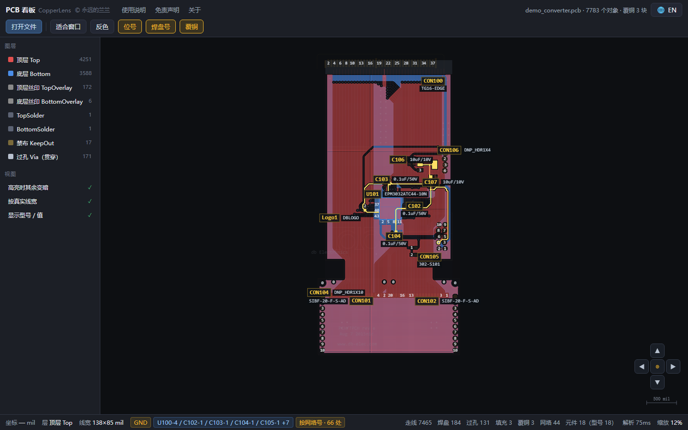

> 格式名（`PCB 4.0 Binary File`）只出现在"能读什么"里，用来描述兼容性，不作商标使用；
> 详见文末《发布与合规》。

## 能读什么

| 文件 | 说明 |
|---|---|
| `.pcb`（`PCB 4.0 Binary`） | 单块板，1998–2000 年前后那一代设计文件 |
| `.ddb`（设计库） | 一次抽出库里所有板子，**每块板各占一个页签**，能并排对照 |
| `.kicad_pcb`（KiCad） | KiCad 6 / 7 / 8 / 9 / 10 的板文件（纯文本）；4、5 版的老格式也认。见「v1.14 重点」 |
| **Gerber + 钻孔**（`.gbr` `.gtl` `.gbl` `.gko` `.drl` `.xln` …） | 板厂给的那一包制造文件，**一层一个文件，整包一起拖进来合成一块板**；也可以直接给 `.zip`。见「v1.15 重点」 |
| 立创EDA **标准版** `.json` | 立创EDA 导出的板文件（纯文本 JSON）。见「v1.16 重点」 |
| `.brd`（Eagle） | Autodesk Eagle / Fusion 360 的板文件（纯文本 XML）；内层、覆铜、底面镜像元件都按原样解析。见「v1.18 重点」 |
| 立创EDA **专业版** `.epro2` / `.epro` | 整个工程包直接拖进来，里面那份 `.epru` 设计日志会自己解开。见「v1.16 重点」 |
| **维修点位图** `.bvr` `.bv` `.bdv` `.cad` | 手机、笔记本主板维修用的那一族；只有位号、焊盘、网络和板框，没有铜箔图形。见「v1.19 重点」 |
| **ODB++**（`.zip` / `.tgz` / 一个目录） | 板厂给的制造数据。**带网络名和层名**，所以焊盘能对上"这颗料第几脚"，比 Gerber 能查线。见「v1.20 重点」 |
| **PADS** `.asc`（Layout / PowerPCB 导出） | Mentor / Siemens PADS 的 ASCII 板文件（纯文本、分段式）。**带网络名、位号、脚号**；阻焊/钢网/通孔焊盘栈、覆铜弧、内层都认。见「v1.21 重点」 |
| **Altium** `.PcbDoc` | Altium Designer 的板文件。默认保存是二进制（复合文档），另存时也能存成 ASCII（File → Save Copy As），**两种都认**；层名用设计者自己起的（`L2` / `GND` / `PWR`）。见「v1.22 重点」 |
| 维修界的 `.brd` | 和 Eagle 同名不同物（Landrex / TestLink 点位图），按内容自动分开 |

明确**不做**：原理图（`.sch`）、`PCB 3.0`（更早的 16 位版本，部分兼容、未逐一验证）。
宁可明确报错，也不给一张假图 —— 照假图查线是要出事的。

## 用法

双击 exe → 先过一段**海报**（几秒，点一下可跳过）→ 进**首页**；
首页点「打开文件」选 `.ddb` / `.pcb` / `.kicad_pcb` / 立创 `.json` / `.epro2` / Gerber（同一个对话框），
也可以把文件拖到 exe 图标上，或拖进窗口。**手上没文件也能打开程序看界面**。

点一下走线或焊盘 → 与之电气相连的整条铜亮黄，状态栏写出具体脚位。
**按 <kbd>H</kbd>（或顶栏「覆铜」按钮）→ 一键收起所有铺铜，细走线立刻看清。**

### 快捷键

| 键 | 作用 |
|---|---|
| <kbd>F</kbd> | 适合窗口（整板入画） |
| <kbd>H</kbd> | 覆铜显示 / 隐藏 |
| <kbd>G</kbd> | 定位网格 A1~H8（打印前先开它） |
| <kbd>K</kbd> | 两点通不通 |
| <kbd>D</kbd> | 量距 |
| <kbd>Ctrl</kbd>+<kbd>F</kbd> | 找元件 / 找网络 |
| <kbd>Esc</kbd> | 清高亮（量距过程中先退量距） |
| 方向键 | 平移（按住 <kbd>Shift</kbd> 走得更快） |
| <kbd>+</kbd> <kbd>-</kbd> | 缩放 |
| <kbd>0</kbd> | 回到板子中心 |
| 中键 | 关掉当前页签 |

鼠标：滚轮**以指针位置为锚点**缩放；**按住左键拖到画布边缘，画面自己往那个方向走**
（越靠边越快，松手就停）；放大后**左上角缩略图**里的黄框是当前视野，点一下跳过去；
板上**右键写一句话**就是一条标记，按板子存档。

## v1.22 重点

**Altium 的 `.PcbDoc`。** 国内画板子用得最多的软件，落到维修台上的机会也就最多。

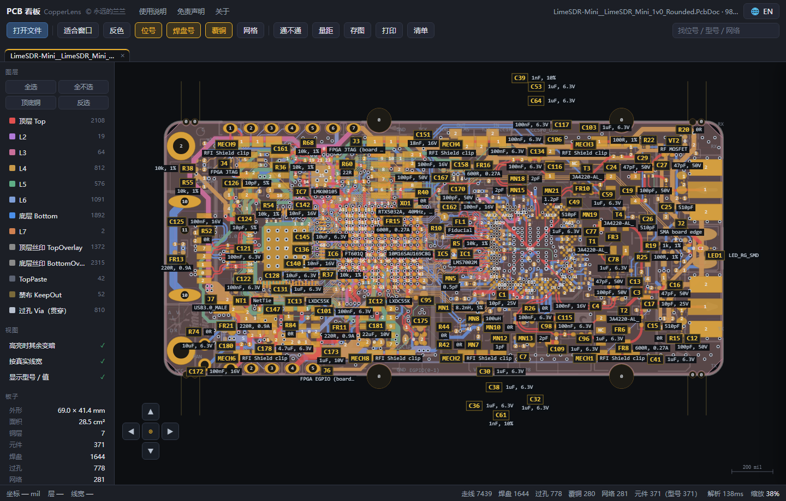

### 一个后缀，两种存法

| 存法 | 怎么来的 | 本程序 |
|---|---|---|
| 二进制（默认） | 平时的保存 | 读（复合文档，里面 `Board6` / `Pads6` / `Tracks6` 一串子流） |
| ASCII | File → Save Copy As → PCB ASCII | 读（一行一条 `\|RECORD=Track\|…`） |

顺带解决一个老问题：`.ddb` 和 `.PcbDoc` 的开头都是复合文档的魔数，
现在靠里面的流名分（有 `MSysObjects` 的是 `.ddb`，是设计库不是单块板），
不会再出现"把整个设计库当成一块板"。

### 打开之后能看到的

- 走线、焊盘、过孔、圆弧、覆铜（新版 Altium 的 Region 也认）、板框、丝印；
- **真网络名和位号**（`C183` 配 `100pF, 50V`，焊盘写 `NetC11_2`），不是靠几何猜；
- **层名用你自己的**：8 层板就显示 `Top / L2 / L3 / L4 / L5 / L6 / L7 / Bottom`，
  跟 Altium 图层面板一模一样；
- 机械层只画机械 1（多数板的板框在这层），装配图、尺寸标注、3D 外形不画 ——
  一块板上这类线常有几千条，全画出来就什么也看不见了。

### 两个容易画错的坑

- **Board 记录里那圈顶点常常不是板框，是设计图纸的外框。** 照它画，屏幕上就是
  一个空荡的大方框套着一小块板。现在只要文件里有 Keep-Out / 机械 1 的线，
  就信那些线，不信 Board 记录。
- **ASCII 版的位号不跟元件绑。** 它把 `R7` 画成一条独立文字，只能靠"离哪颗元件最近 +
  长得像位号 + 在丝印层上"认回来；认不回来就留空，不硬凑一个错的。

## v1.21 重点

**PADS 的 `.asc`：Mentor / Siemens PADS（Layout、PowerPCB）导出的 ASCII 板文件。**

它和 `.kicad_pcb` 一样是纯文本，但结构是"分段"的：段名用 `*名字*` 括起来，
一段管一件事（`*PARTDECAL*` 封装、`*PART*` 元件、`*NET*` 网络、`*ROUTE*` 布线、
`*POUR*` 覆铜、`*LINES*` 线表、`*MISC*` 层定义……）。

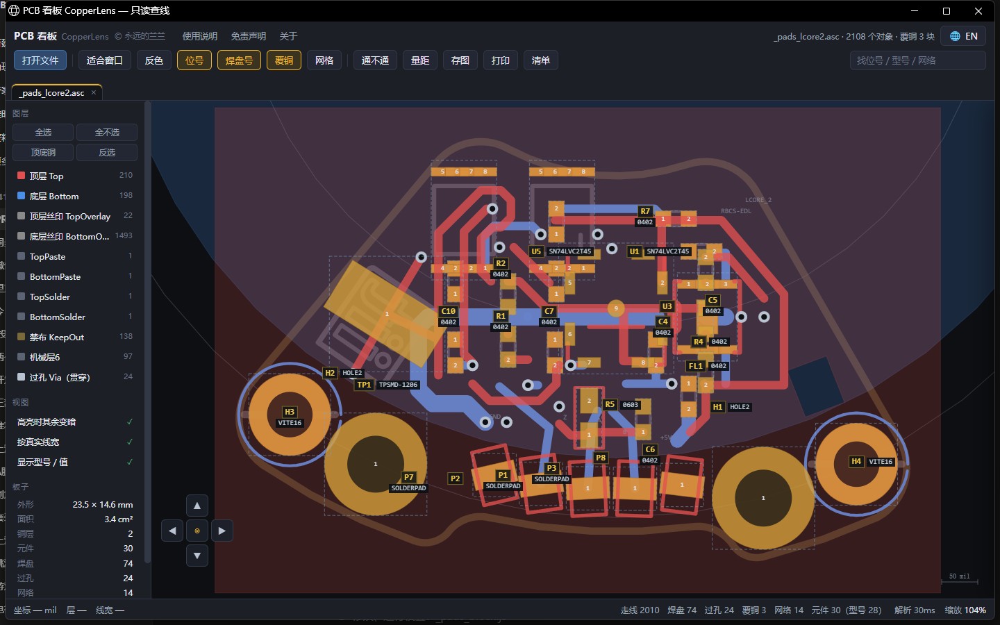

### 一个 `.asc`，三种东西

同一个导出对话框里还能勾出网络表和原理图，三者都是 `.asc`：

| 第一行 | 是什么 | 程序怎么做 |
|---|---|---|
| `!PADS-<产品>-V<版本>-<单位>!` | 板文件 | 正常打开 |
| `*PADS-PCB*` | 网络表 | 明说"只有连接关系"，教你重导 |
| `*PADS-LOGIC*` / `*PADS-POWERLOGIC*` | 原理图 | 明说"不是板文件"，教你重导 |

**还有一个更阴的**：文件头是板文件的 `!PADS-`，但里面只有 `*PART*` + `*CONNECTION*`
+ `*SIGNAL*` —— 那是导出时只勾了网络表。这种会明确告诉你"没几何段、重导一次"，
而不是给你一张空白板。

### 四个不懂就会画错的细节

| 细节 | 真相 |
|---|---|
| 单位 | 有 `MILS` / `INCH` / `MM` / **`BASIC`** 四种；BASIC 是 1/38100 英寸，坐标动辄上千万 |
| Y 轴 | **朝上**，和本程序一致，**不用翻** |
| 顶点行里的层号 | `0` = 还没布的飞线（不画）、`65` = 这根线到此接上元件脚（不画） |
| 弧的圆心 | 顶点行只给 `CW`/`CCW`，**带标志的那个点就是圆心** |

线表里的弧角点则是八个数：`x y 起始角×10 扫角×10 包围盒四角`，圆心取包围盒中点。
当普通点读，板框上就会冒出几条斜穿全板的直线。

### 焊盘栈：阻焊和钢网分开画

PADS 的一个焊盘是"每个层一行"的栈：`-2` 顶层、`-1` 底层、`0` 内层，
正数则是文件里声明的那些层。有些导出会把**阻焊和钢网**也写进栈里
（`21 600 R` 表示阻焊层比铜皮放大到 600）。这些现在落到本程序的阻焊层、钢网层，
所以"这块板哪些脚有钢网"这种事一眼能看出来。

**层 0 是"内层"，不是"所有铜层"** —— 两层板上它等于不存在。早期版本图省事，
见 0 就给顶底各补一块，结果一个通孔焊盘变成四块。

### 位号放在原厂摆的位置

封装里带着文字记录（`Ref.Des.` / `Part Type`）和它们的偏移、角度、字高。
照它放，位号就落在原厂摆的地方；不照它放，位号会糊成一坨压住焊盘。

### 首屏按板框取景

PADS 的图框和图例常甩在离板子很远的地方（整份 bounds 能有板子的四倍）。
现在解析器自己给一个取景框（板框外扩 4%），打开就是板子铺满画面。

## v1.20 重点

**ODB++：板厂给的那包制造数据。**

Gerber 和 ODB++ 是同一件事的两种做法，区别一句话：**Gerber 只有图形，ODB++ 带网络名。**
所以 Gerber 里"点一颗焊盘问这是哪个网络"只能靠几何连通性去猜，而 ODB++ 里这行字本来就有。

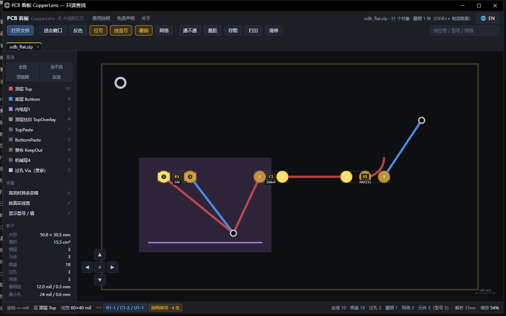

### 它长什么样

不是"一层一个文件"，而是一棵目录树，压成 zip / tgz 交出去：

```
matrix/matrix                              层清单：哪层是铜、哪层在上
steps/<板名>/layers/<层>/features           每层的几何（P 焊盘 / L 线 / A 弧 / S 面）
steps/<板名>/layers/comp_+_top/components   位号 + 每个脚的坐标 + 网络号
steps/<板名>/netlist/cadnet                 网络号 → 网络名
steps/<板名>/layers/drill/features          钻孔
```

### 网络是怎么回填的

铜层记录里**一个网络名都没有**。网络在另外两个文件里：`components` 的 `TOP` 记录写着
"这个元件的这个脚在 (x, y)，属于 3 号网络"，`netlist` 的 `$` 表写着"3 号网络叫 GND"。
两边按坐标对号，焊盘才有名字。这一步做对了，状态栏才会写出
`GND　R1-1 / C1-2 / U1-1`；做错了，就只剩一片"未分配网络"。

### 三个到手方式都认

`.zip`、老派的 `.tgz` / `.tar.gz`、以及**用户自己解开之后的那个目录**（直接拖到图标上）。
包里只挑要用的那几类文件读，`fonts` / `misc` / `user` 不占内存。

### 两个坑

- **单位**：坐标跟 `UNITS=INCH|MM` 走，符号却可能自带 `I` / `M` 后缀，而英制符号
  爱用 mil、公制符号爱用 micro —— `r6` 是 6 mil、`r150` 可能是 0.15 mm。做法是先按
  声明换算，再过量级体检：落在 1~600 mil 之外就换个解释重算。
- **层名**：matrix 只说"这层是 SIGNAL 还是 SILK_SCREEN"，行号顺序各家不一。
  铜层按"最上 = 1、最下 = 32、中间 39/40…"编号，层名原样显示（`顶层 · top`）；
  matrix 没写 LAYER 块时按目录名认，`sst` / `smt` 这种三字母叫法要专门排除，
  否则丝印会被当成铜层。

### 这一版仍不做

面积里的**洞**和**负极性的面**不挖空（大面积铺铜会显得偏满，但查线不受影响）；
`eda/data` 的封装定义没读（位号型号已经从 `components` 拿到）。

---

## v1.19 重点

**点位图（BoardView）：维修现场真正天天在用的那一族。**

### 为什么这一版重要

前面几版读的都是"工程师的板文件"。但手机、笔记本主板维修的师傅手里没有设计工程，
他们用的是**点位图** —— 只存位号、焊盘坐标、网络名和板框，没有铜箔图形。

而这四样，恰好是我们查线、找脚、测点、孔表全部功能所依赖的：点一个焊盘要能亮起
整条网络，靠的就是网络名；要能说"E5 那颗电容"，靠的就是位号。所以缺的从来不是
渲染能力，只是一个能读进来的解析器。

### 一次补齐五种写法

| 来源 | 认法 | 坐标单位 |
|---|---|---|
| `BVRAW_FORMAT_3` | 一行一个 KEY VALUE | mil |
| `BVRAW_FORMAT_1` | 制表符分隔，`<<Layout>>` / `<<Pin>>` / `<<Nail>>` | 英寸 |
| BDV | `<<format.asc>>` / `<<pins.asc>>` / `<<nails.asc>>` | 英寸 |
| BRD（Landrex / TestLink） | `str_length:` / `var_data:` / `Format:` / `Parts:` / `Pins:` / `Nails:` | mil |
| CAD | `COMP` / `C_PIN` / `NET` / `N_VIA` | 英寸 |

对外就是四个扩展名：`.bvr` / `.bv` / `.bdv` / `.cad`。拖进来就行，不用先转格式。

### 两种是被混淆过的

BDV 每行一个滚动密钥（从 `0xA0` 起，每见一个换行加 1，超过 285 归 159）；
BRD 整篇做一次"循环左移 2 位再取反"。都不加密钥，所以能解开 —— 但认的时候
得靠内容：BDV 看明文标记，BRD 看开头 4 字节 `23 E2 63 28`。

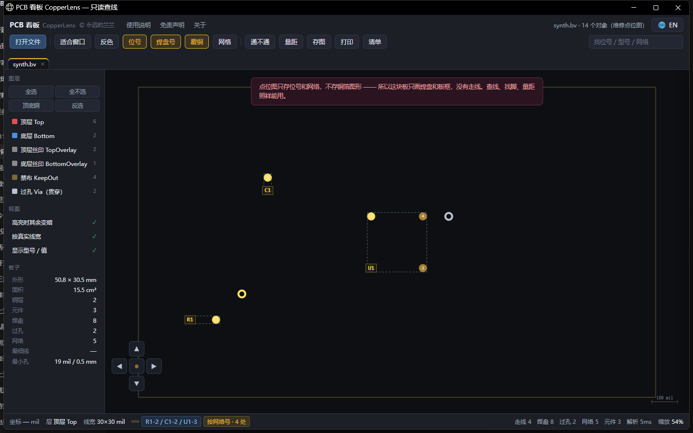

### 打开之后长什么样

只有焊盘（30 mil 的圆点）、位号、板框和测试点，**没有走线** —— 因为文件里本来就没有。
打开时会提示一句，免得你以为没渲染出来。

但查线照样能用：点一个焊盘，同一条网络的所有脚一起亮；找位号、量距、孔表、测点清单
全部正常。这些功能本来就只依赖网络名和坐标。

### `.brd` 现在有三家

Eagle（XML）、Landrex / TestLink 点位图（六段文本）、Cadence Allegro（二进制）。
前两家都支持，按内容自动分开；第三家读不了，但会明确告诉你"这是 Allegro"，
而不是笼统报"只认…"。

---

## v1.18 重点

**第六种格式：Eagle 的 `.brd`。** 另外两件是"一直看着别扭、但一直没空动"的：
内层不再一律紫色、覆铜浓度按本层片数自适应。

| 之前 | 现在 |
|---|---|
| 开源硬件里相当一部分是 Eagle 画的，**`.brd` 打不开** | 纯文本 XML 直接读，Eagle 4 ~ 9.6 都认 |

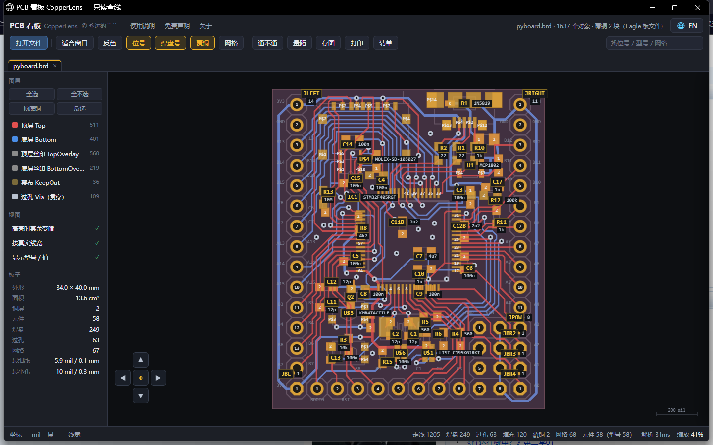

上面这块是 pyboard（MicroPython 官方板，Eagle 6.5）：249 个焊盘全部认出位号，
元件清单是「C1 · 12p」这样一位一号；点一条 GND，亮出来 45 只脚 + 12 个过孔，
状态栏直接写 `IC1-12 / C1-1 / C10-2 …`。

### 四处必须翻译的地方

Eagle 的文件跟前面几种都不一样，照直觉写会画歪：

| 坑 | 说明 |
|---|---|
| 单位是 mm | 内部一律 mil，进来先乘 39.37 |
| **底层是 16，不是 2** | 2~15 全是内层。照 1/2 处理，四层板的内层会叠到顶层上 |
| 焊盘尺寸在库里 | 元件只写"用哪个封装、放哪儿、转了多少度"，焊盘得按 rot / mirror 逐个实例化 |
| 网络写在 `<signals>` 里 | `contactref` 指明哪只脚属于哪条网，焊盘本身不带网络 —— 先扫一遍建表，回头补 |

还有两个细节：圆角板框、圆弧走线是 `<wire curve="90">`（弦长 + 圆心角反算圆心）；
底面元件是 `rot="MR90"`，层号要跟着翻（1↔16、tPlace↔bPlace），
不然底面元件的丝印会印到顶面上。

覆铜按外轮廓画 —— Eagle 的真实铺铜是它自己算出来的（要避让、要留 isolate），
我们拿不到那份结果，跟立创专业版的处理方式一致。

### 顺便修的两件

- **内层不再一律紫色**：四层板有两个内层、六层板有四个，全给一个颜色根本分不清
  哪条线在哪一层。改成按序号循环取色，冷暖交替；文件里给内层起的名字（GND / PWR）
  也接进了图层面板，显示成"内层 1 · GND"。
- **覆铜浓度按片数自适应**：立创专业版一块覆铜拆成上千片，浓度得压到 0.028；
  Eagle 一块 GND 平面就是一整片轮廓，同样的 0.028 在深色底上几乎看不见 ——
  打开板子还以为覆铜没画。现在 ≤6 片用 0.20、≤80 片用 0.075、更多才回到 0.028。

### ODB++ 还是没进

上次说的"比较难的两个"，Eagle 这版做完了，ODB++ 没做。原因很实在：
**它是板厂给的制造数据，开源样例极少，拿不到可信样本就只能盲写** ——
盲写的解析器在真文件上必然出岔子，那比不做更坏。

能做的先做了：拖进 ODB++ 的包（`.tgz` / `.zip`，里面有 `matrix/matrix` 和 `steps/`）
时，现在会明确告诉你"这是 ODB++、本程序还不读、该跟对方要什么格式"，
不再弹一句"只认 Gerber"。桌面版和在线版都认。

## v1.17 重点

**这一版没有新增文件格式，全是"把手上这块板讲清楚"的工具。** 四样东西都不是看图的锦上
添花，而是维修台上、打样报价单上真要交出去的。

### 一、定位网格 A1~H8

顶栏「网格」或 <kbd>G</kbd>：板面按行列切块，**列是数字、行是字母**，于是"E5 那颗 1uF"
成了一句对方照着屏幕也找得到的话。

行列数按长宽比自动算（长边约 10 mm 一格，夹在 5~14），不用手动设 —— 30 mm 的小板给
5×5，69.6×30.0 mm 的泰山派核心板给 7 列 × 3 行（一格 9.9×10.0 mm）。坐标字贴在板框外侧，
板框被拖出画布时改贴画布边。

### 二、孔表：打样报价按孔型算钱

「清单 → 孔表」：全板要下钻头的孔按孔径归堆（过孔 + 插件脚，贴片焊盘没有孔）。
一行写孔径 mil / mm、过孔数、焊盘数、合计；点一行 → 这个孔径的孔全亮并飞过去。
可复制、可导出 CSV。

按 1 mil 归组是必须的：同一个钻头在不同封装里会写成 31.5 和 32.0，不归堆就冒出一堆
只差 0.5 mil 的重复行，看着像板子有几十种孔型。

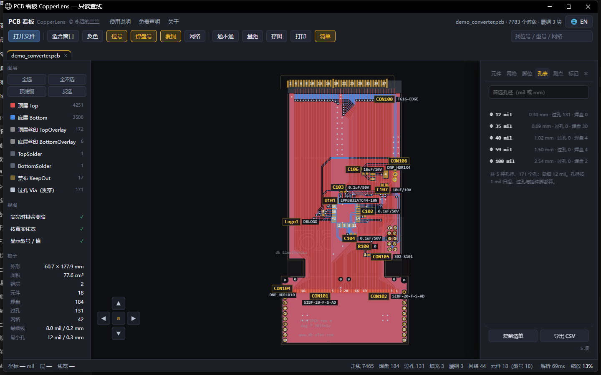

### 三、A4 出图：先看纸、再打印

顶栏「打印」先给一张 A4 预览（白底、板子铺满、上面一行板名和尺寸、下面一行出图信息），
满意再点「打印…」；板子横向就自动横向出纸。图按 2400 px 长边超采样，约 330 dpi。
纸上点不了，所以打之前先按 <kbd>G</kbd> —— A1~H8 是纸上唯一的坐标。

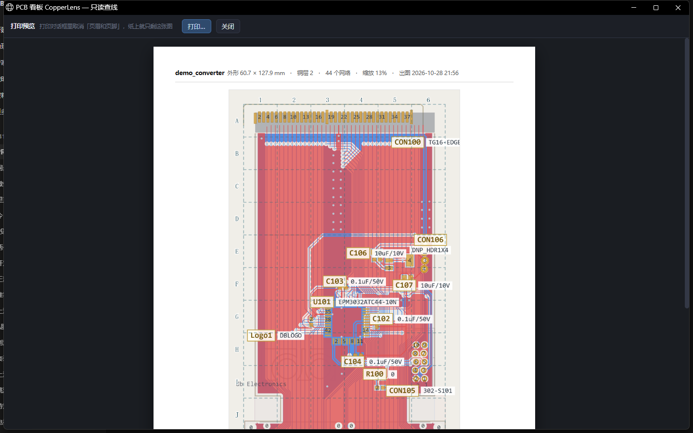

### 四、测点：每条线在哪儿下探头

「清单 → 测点」：**每条网络只给一处最好下探头的点**（短边最宽者优先，通孔焊盘同分略优先）。
一行写清网络名、`R12-1` 这样的脚位、尺寸；点一下只点亮这一处并居中。

关键一条：**焊盘短边不到 20 mil（BGA 底下那种细球）时，如果这条网络有孔，就直接改推
这条线上最大的那颗过孔** —— 铜环裸露在板面上，同样尺寸也比压在器件底下好搭得多。
泰山派实测 400 条网络：203 条改推过孔、96 条实在没得推标「小」、101 条是正常焊盘。

（真实板子上很少有 `TP1`/`TP2` 这种位号：泰山派 1963 个焊盘里一个都没有，
所以"列出所有测试点"这条路走不通，只能按网络倒推。）

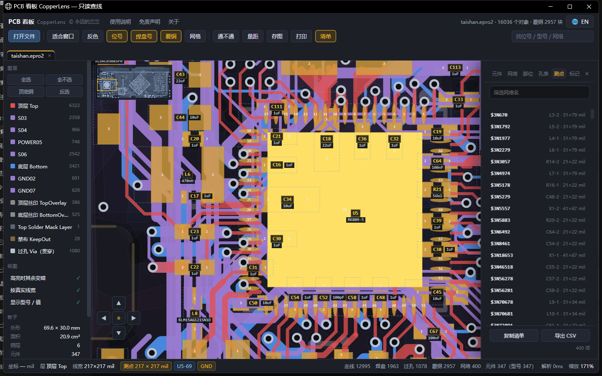

## v1.16 重点

**立创EDA（EasyEDA）两种版本的板子都能看了。** 标准版是 `.json`，专业版是 `.epro2` / `.epro`
工程包 —— 国内打板圈最常用的就是这两样，对方给文件十有八九是它们。

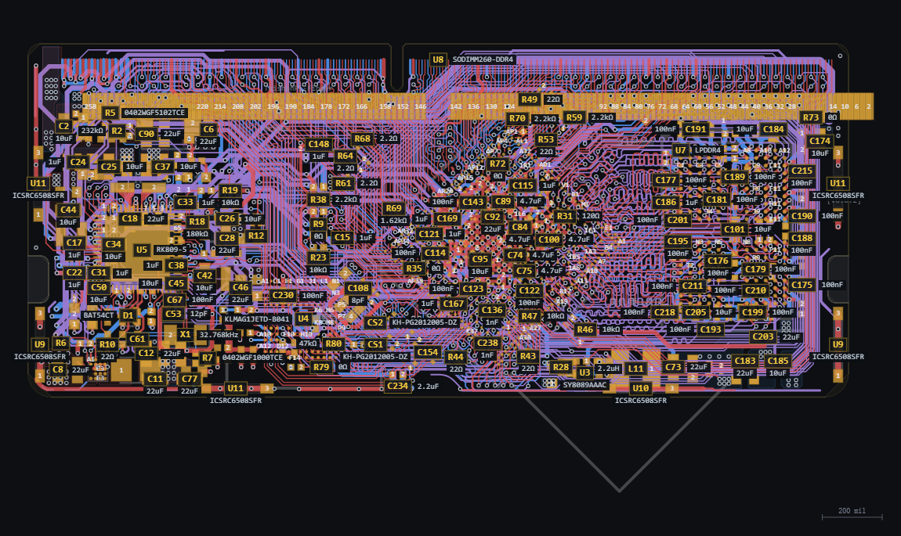

<sub>演示用板：**立创·泰山派 RK3566-1F 金手指核心板**，作者「立创开发板」（LCKFB），
来自[立创开源硬件平台](https://oshwhub.com/li-chuang-kai-fa-ban/tai-shan-pai-1f-jin-shou-zhi-he-xin-ban)，
按 **CC BY-NC-SA 4.0** 许可展示。截图由本程序渲染其公开的设计数据得出，未经修改；
本程序不附带该设计的任何工程文件。详见 [第三方组件与许可.txt](第三方组件与许可.txt)。</sub>

| 之前 | 现在 |
|---|---|
| 只有 Protel、KiCad、Gerber 三条路，**立创画的板打不开** | 标准版 `.json` 直接拖；专业版 `.epro2` 整个工程包直接拖 |
| — | 铜层按板子自己的名字列：`GND02` / `S03` / `POWER05` / `GND07`，不是笼统的"内层 1" |
| — | 焊盘带真实网络名（`I2C5_SCL_M0`、`VCC_3V3`），查线、清单照样按名字走 |
| — | 位号与型号从器件库里翻出来：`U6 = RK3566`、`R70 = 2.2kΩ` |

专业版那个包其实是 **zip**，里面除了一堆图片，真正的板子只有一份 `.epru` **设计日志**：
一行一条变更，形如 `{"type":"LINE","ticket":2414,"id":"e27"}||{"layerId":1,"startX":…}|`，
左边是流水号，右边才是内容 —— 所以读法是"按日志重建"，不是"按表取数"。

### 五个坑（都踩过）

1. **元件和它的属性分两行存，先后顺序不保证** —— 属性行可能排在同一条元件之前。
   边读边合会丢掉一半位号，得先全收着，扫完再统一并。
2. **封装 uuid 必须整串匹配。** 属性里的 `Footprint` 是 `49e9c3dbcc05e765_a816…` 这种整串；
   我一开始按 `_` 截断去前缀，结果把 8 个不同的封装并成同一个，单个元件摊出 2114 个焊盘，
   整板虚报 **17818** 个（实际 1963）。
3. **焊盘的孔是个对象，不是数字**：`{"holeType":"ROUND","width":40,"height":40}`。
   长圆孔（SLOT）要取短轴才是钻孔径，取 `width` 会把槽长当孔径。
4. **焊盘网络在 `PAD_NET` 里，而它的 `id` 是"字符串化了的数组"** ——
   `"[\"PAD_NET\",\"e0\",\"2\",\"e12\"]"`。不拆开这一层，所有焊盘的网络号都是 0。
5. **`REGION`（禁止布线区）用的是画布局部坐标**，跟板坐标不是一个原点。硬当铜画，
   板子下面会凭空多出一个菱形和一个大灰框 —— 现在直接丢掉。

验证用的是立创官方开源工程「泰山派1F 金手指核心板」（RK3566，8 层板，260 针金手指）：
**12995** 段走线 / **1963** 个焊盘 / **1078** 个过孔 / **347** 个元件 / **400** 个网络，
板框量出 **69.6 × 30.0 mm** —— 正好是 DDR4 内存条那个尺寸。
标准版另外两块真板（2 层 / 4 层）37 项断言、专业版 42 项断言（含 exe 传数据的两条通道），全过。

### 立创这两版的边界（先说清楚）

- **专业版的覆铜（POUR / POURED）不展开**：它存的是归一化坐标，跟板坐标不是一个原点，
  硬画整片错位。所以内层电地平面看起来是"空的 + 一片过孔"，这是实情，不是漏画。
- **只读 PCB**：工程包里的原理图、多板结构不读。
- **型号偶尔只有料号**：器件库里没填值的时候只能显示料号（比如屏蔽夹），长句会截短到 18 个字显示。
- **那份日志很大**：泰山派这块板的 `.epru` 有 18 MB。exe 把它压缩到 **14%** 再交给显示端
  （3.5 MB），双击打开照样是秒开；否则内嵌页面会胀到 24 MB。

## v1.15 重点

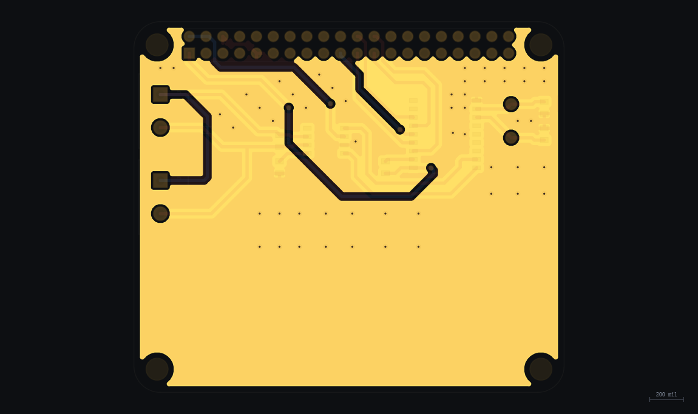

**现在能看 Gerber 了 —— 也就是"板厂手里那一包文件"。** 这是唯一一种所有 EDA 都导得出的格式，
所以从此不论对方用什么软件画的板，只要能导制造文件，这里就能看。

| 之前 | 现在 |
|---|---|
| 只有对方愿意给原始工程文件（`.pcb` / `.kicad_pcb`）才看得了；**维修现场最常见的"只给一包 Gerber"完全打不开** | 一层一个文件，整包一起拖进来合成一块板；`.zip` 也行 |
| — | 光圈的直径当线宽 / 焊盘尺寸；钻孔按坐标套到铜皮上，套不上的当安装孔单独画 |
| — | 没有板框层就按铜皮外包补一圈，尺寸照样量得准 |
| — | 导出时勾了 X2 属性的，网络名和位号能接回来，查线和清单照样按名字走 |

三件必须按实情处理的地方：

- **零直径光圈**（`ADD10C,0.0000`）只是"抬笔挪位置"，不能落笔 —— 当真画成线，一块板会凭空多出几千条假线。
  板框层反过来：Altium 的机械层就是用 0 宽光圈画轮廓的，得给一个最小宽度，否则板子没边框、尺寸只能靠猜。
- **钻孔的小数位要跟着同批 Gerber 走**：RPI CAN Hat 的 Gerber 是 `FSLAX25`（5 位小数），钻孔 `X174291`
  就是 1.74291 英寸；DCF77 是 `FSLAX24`（4 位），同样的 `X26114` 是 2.6114 英寸。按固定 2:4 算会整整差 10 倍。
- **钻孔文件的名字各家各样**：Altium 叫 `.TXT`、Eagle 叫 `.drd`、KiCad 叫 `.drl`。所以只点中其中一层时，
  程序会按内容（有没有 `M48` 头）去同目录把同一块板的其它文件找齐 —— 不用按住 Ctrl 一个个点。

验证用的是两块真实板子（都取自开源仓库里的板厂成品包）：Raspberry Pi CAN HAT（Altium 导出，9 层 + 钻孔）
和 DCF77 时钟模块（Eagle 导出，含八角焊盘宏）。外形分别量出 **65.0 × 56.0 mm** 与 **99.0 × 74.5 mm**，
孔数与源文件的坐标行数逐个对上（106 / 98），33 项断言全过。

### Gerber 的边界（先说清楚）

Gerber 是**制造文件**，不是设计文件：它只描述形状，不写哪里是 GND、哪颗是 R1（除非导出时勾了 X2）。

- **清单里通常没有位号** —— 丝印上的字是被"描"成一条条线段的，没有文字语义，读不出 `R1`。
  只有 X2 属性里带了位号的才有。
- **查线变成"按铜皮连"**：没有网络号，就按几何接触去找相连的铜。结果通常是对的，
  但遇到大面积铺铜会一次点亮一大片 —— 因为它们在电气上确实连着。
- **过孔不单独统计**：Gerber 里的过孔就是铜层上的一个小圆，和圆焊盘长得一样，没法区分。
- **覆铜是"线填充"**：一大片铺铜在文件里是几千条密集的线，画出来就是满版实心色。想看清细走线，
  按 <kbd>H</kbd> 收起覆铜，或者在图层面板里关掉那一层。

## v1.14 重点

**现在也读 KiCad 的板子了。** 自己画的新板子（KiCad 6–10）不用再转成别的格式，直接拖进来。

| 之前 | 现在 |
|---|---|
| 只认 Protel / Altium 那一代的老文件，**自己画的 KiCad 板反而打不开** | `.kicad_pcb` 直接读：KiCad 6 / 7 / 8 / 9 / 10，连 4、5 版的老格式也认 |
| — | 走线、焊盘、过孔、覆铜、板框、丝印、位号、型号全部读出来；**查线、量距、清单定位、板子尺寸**一样能用 |
| — | 层名按 KiCad 的叫法显示（`F.Cu` / `B.Cu` / `Edge.Cuts`），不用记编号 |
| — | 板子外形量的是 `Edge.Cuts`，和 KiCad 里看到的一致 |

要过三道坎：KiCad 存**毫米**（本程序内部用 mil）、**Y 轴朝下**（本程序朝上）、
网络在 KiCad 10 里只存**名字**、6–9 存**编号**。三条都按文件版本分开处理。

验证用的是三块真实板子（KiCad 4 / 5 / 10）加一块最小 KiCad 8 板做板框精度校验：
22 项断言全过，同时把 Protel 那条老路径完整回归了一遍（14 项）。

## v1.13 重点

**点清单不再"怼脸"、同一个设计库里的多块板能并排开着，另外补了量距、板子尺寸、缩略导航和最近打开。**

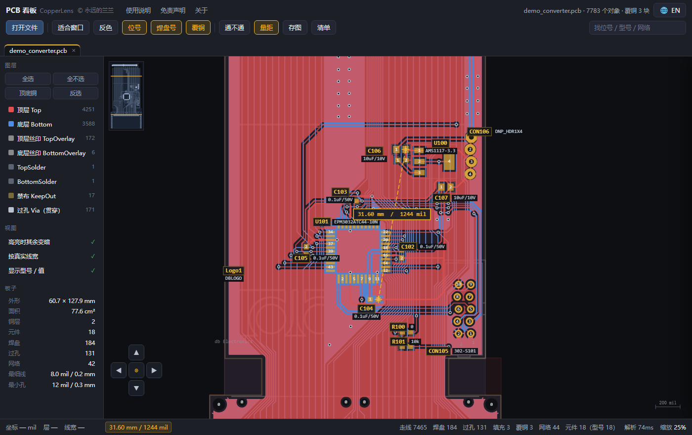

| 之前 | 现在 |
|---|---|
| 清单里点一颗 0402，画面直接怼到只剩两颗焊盘，得先滚轮缩小才认得出它在板子哪儿 | 元件占屏约三分之一，**周围留出位置感**；放大后左上角还有**整板缩略图**，黄框标出当前视野，点一下跳过去 |
| 想挪视角只能按方向键；拖到窗口边缘就拖不动了 | **拖到画布边缘，画面自己往那个方向走**（Protel 的手感），越靠边越快，松手就停 |
| 方位按钮被右侧清单抽屉盖住，找不到 | 方向盘搬到**左下角**，抽屉在右边，两个永远不抢位置 |
| 想知道两点差多少毫米，只能靠数格子和比例尺 | **量距**（<kbd>D</kbd>）：点两个点，黄虚线连着，读数同时给 `mm` 和 `mil`，落点自动吸到焊盘圆心 |
| 文件里明明有板子尺寸、最细线宽、最小孔径，界面一个都没显示 | 左栏「**板子**」：外形 mm、面积、铜层、元件/焊盘/过孔/网络数、最细线、最小孔；点元件多给一行**外形尺寸 + 脚数**，点网络给**布线总长 + 孔数** |
| 同一个 `.ddb` 换一块板，上一块就被冲掉了 | 下拉框选板 = **新开一个页签**，上一块原样留着，可以左右对照；已开过的那块再选是切过去，不重复解析 |
| 每次都要翻文件夹找上次那个 `.ddb` | 首页列出「**最近打开**」（只记本机路径，不上传），点一下直接开 |
| 窗口关了，exe 偶尔还在后台赖着 | 关窗时页面主动打招呼（`pagehide` → beacon），exe 立刻退；按 <kbd>F5</kbd> 刷新不会被误判成关闭 |

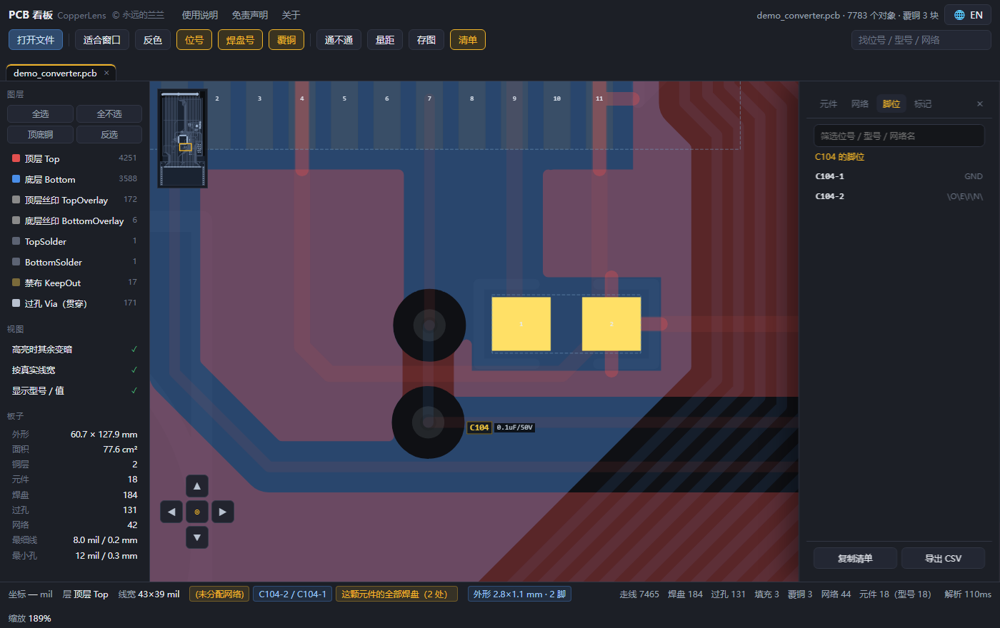
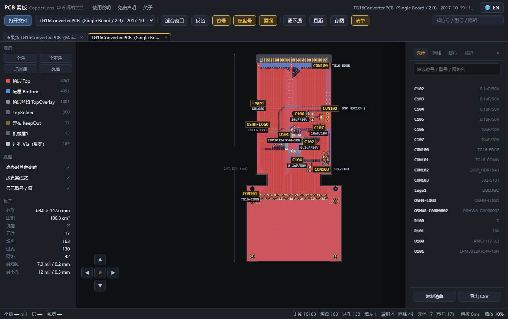
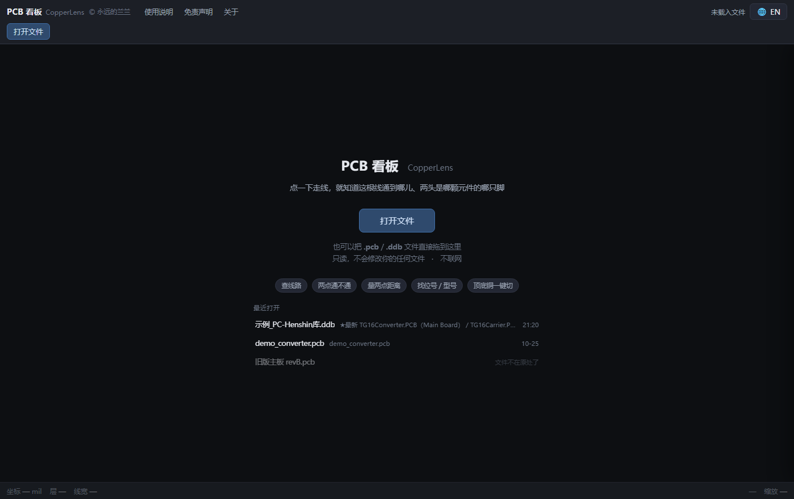

几个实现上的取舍（细节见 [CHANGELOG](CHANGELOG.md)）：

- **定位留白不是拍脑袋的比例**：按比例留白（目标占屏 ~1/3），并加了一条硬上限
  —— 屏幕短边至少装下 360 mil（约 9 mm），不然小料照样被放到看不见周围。
- **边缘平移用 `setTimeout` 自循环，不用 `requestAnimationFrame`**：窗口被别的窗口挡住、
  或页面在后台时，浏览器会把 rAF 挂起，指针贴在边上画面一动不动。
- **缩略图是离屏画的**：载入时画一次（只画走线和焊盘，跳过几千条覆铜填充线），
  之后每帧只是 `drawImage` + 一个黄框；整板都看得见时自动收起。

## 其它常用功能

| 功能 | 说明 |
|---|---|
| **查线** | 点走线/焊盘 → 整条网络亮黄，状态栏写脚位。点接地只亮焊盘与过孔，不把整板刷成一片黄 |
| **通不通**（<kbd>K</kbd>） | 点两点给结论：按网表 → 同片覆铜 → 实际铜皮连通，三层判据，老文件也能判 |
| **清单抽屉** | 右侧列出全部位号 + 型号、全部网络与脚数；点哪条跳哪条；一键复制清单 / 导出 CSV |
| **板上标记** | 右键写一句话（"这里烧过"），插旗存档，换板不串 |
| **图层** | 单击切换、双击只看这层；四个按钮：全选 / 全不选 / 顶底铜 / 反选 |
| **存图** | 当前画面（含位号、型号、高亮）一键存 PNG，文件名带板名和时间 |
| **多页签** | 一个文件一个页签，切回来缩放/平移/图层/高亮全部还原 |
| **中英双语** | 右上角 <kbd>🌐</kbd> 切换，按钮上写的是"对方"的语言 |

更多界面：`预览_全板标注.png`、`预览_清单_网络.png`、`预览_清单_脚位.png`、
`预览_标记.png`、`预览_多页签.png`、`预览_海报.png`、`预览_英文界面.png`、`预览_免责声明.png`。

## 隐私与安全

- **只读**：只读文件，**绝不修改、覆盖、删除**你的原始文件。
- **不联网**：显示内核跑在本机回环（`127.0.0.1` 随机端口 + 一次性令牌），
  **不监听网卡、不上外网、不写注册表**。在线版也是纯前端，文件不出浏览器。
- **不留痕**：只有两处写盘 —— 临时目录（读 `.ddb` 时的中转文件，退出即清）和
  首页「最近打开」的一份本地清单（只存路径、板名、时间，纯本地）。
- **无第三方库**：绘图与解析全部自己实现，没有运行时依赖注入。

## 兼容性

| 项 | 值 |
|---|---|
| 目标系统 | Windows 7 / 8 / 8.1 / 10 / 11，**x86 与 64 位都可** |
| exe PE 头 | `0x014c` = i386（32 位） |
| exe Subsystem | `2` = Windows GUI（无控制台窗口） |
| 运行库依赖 | 仅系统 DLL（comdlg32 / user32 / kernel32 + UCRT），无 tcl/tk、无 WebView2 |
| 浏览器要求 | 系统自带的 Edge / Chrome 任一（用于 `--app=` 独立窗口） |

## 已知限制

- **原理图（`.sch`）不做**：设计库里原理图是 OLE 复合文档且引用元件库，复杂度远高于 PCB。
- **DDB 内部结构直接读不做**：Jet 数据库的大字段跨 2KB 页存，页头会插进记录流，
  段一大就整段错位。宁可明确报错，也不给假图。
- 只支持 `PCB 4.0 Binary`；`PCB 3.0`（16 位版）部分兼容，未逐一验证。
- **KiCad 的自定义焊盘 / 梯形焊盘按矩形画**：外形接近，但不是逐点还原；
  圆弧按折线离散（每 8° 一段），放大到极限能看出棱角。
- **KiCad 的规则区（rule area）、3D 模型、尺寸标注不显示** —— 这些不影响查线。
- KiCad 4 / 5 的老文件里位号常常还是 `REF**`（没编号），那种板子的清单里就没有位号可找。
- **立创专业版的覆铜（POUR / POURED）不展开**：文件里存的是归一化坐标，跟板坐标不是一个原点，
  硬画整片错位，所以内层电地平面看起来是空的 + 一片过孔 —— 这是实情，不是漏画。
- **立创专业版的规则区（REGION / 禁止布线区）不画**：它同样用局部坐标，画出来会有一大块游离图形。
- 无代码签名，SmartScreen 可能提示"未知发布者"。

## 重新打包

```bash
py -3.12-32 -m pip install --target _py32 pyinstaller
py -3.12-32 _build32.py
```

**必须用 32 位解释器**，否则打出来是 64 位，32 位 Windows 上跑不起来。
`_build32.py` 会自动在环境变量 `PYI_TARGET` 或脚本旁的 `_py32/` 里找 PyInstaller。
可选参数：`_build32.py <输出目录>`（exe 正在运行时没法覆盖它，先出到旁边再换）。

## 仓库里有什么

```
PCB看板.exe              单文件程序（x86 32 位，走 Release 分发，不进源码树）
index.html               查线内核（单文件网页，中英双语，exe 里内嵌一份）
src/copperlens.py          exe 主程序（对话框文案随系统语言中/英）
src/mdbtools/              mdb-export.exe + DLL（读 .ddb 用，全是 32 位）
src/导出DDB.py             独立导出脚本（备用）
_build32.py               打包脚本（须用 32 位 Python，保证 x86）
使用说明.txt               随包说明
第三方组件与许可.txt        第三方组件、示例文件授权、GPL 源码书面要约
COPYING-GPL-2.0.txt        mdbtools 工具的 GPL 全文
COPYING-LGPL-2.1.txt       libmdb / libiconv 的 LGPL 全文
LICENSE-CERN-OHL-1.2.txt   预览截图所涉开源硬件的 CERN-OHL v1.2 全文
                           （CC BY 3.0 与 CC BY-NC-SA 4.0 无需随附全文，
                             按协议要求给出作者、作品名与协议链接即可）
CHANGELOG.md              逐版改动记录
预览_*.png                 界面预览
```

`.pcb` / `.ddb` 设计文件与 `build/`、`_py32/`、`*.exe` 都不进源码树。

## 第三方组件与许可

| 组件 | 许可 | 用途 |
|---|---|---|
| mdbtools（`mdb-export.exe`） | GPL-2.0-or-later | 读 `.ddb`（设计库） |
| libmdb / libiconv（DLL） | LGPL-2.1 | 同上，动态链接 |
| 预览截图所涉开源硬件设计 ① | CERN-OHL v1.2 | 截图里展示的板子（© René Richard, 2017） |
| 预览截图所涉开源硬件设计 ② | **CC BY-NC-SA 4.0** | 立创·泰山派 RK3566-1F 金手指核心板（© 立创开发板 LCKFB，来自立创开源硬件平台） |

调用方式是**进程外调用 exe**，不与本程序链接成单一作品，因此不传染 GPL。
GPL-2.0 §3(b) 的三年书面源码要约写在 `第三方组件与许可.txt` 第 1 节。

## 发布与合规

分发（拷给同事、发群、放内网共享、上 GitHub）前逐条确认：

| # | 事项 | 现状 | 说明 |
|---|---|---|---|
| 1 | 产品名里不含任何厂商 / 软件名 | ✅ 已做 | 叫 `PCB 看板 / CopperLens`。窗口标题、图标名、exe 名、文件夹名都不带 |
| 2 | 厂商名只出现在"能读什么"的描述里 | ✅ 已做 | 只留格式自身魔数 `PCB 4.0 Binary File` 和扩展名 `.pcb / .ddb` —— 这是**描述性使用**（说明兼容性所必需），不是当商标用 |
| 3 | 不出现厂商图标 / 字体 / 界面素材 | ✅ 已做 | 全自绘，零外部资源 |
| 4 | 免责声明里写明"无隶属关系、商标归各自所有者" | ✅ 已做 | 免责声明第 5 节 + 关于 |
| 5 | mdbtools（GPL-2.0-or-later + LGPL）随附许可证 + 源码书面要约 | ✅ 已做 | 发行包内 `第三方组件与许可.txt` + `COPYING-GPL-2.0.txt` + `COPYING-LGPL-2.1.txt`。GPL-2.0 §3(b) 的三年 written offer 已写进 `第三方组件与许可.txt` 第 1 节 |
| 6 | 代码里不留任何第三方项目名 / 厂商名 | ✅ 已做 | 注释里原有的外部参考已删除，改为「由本人对样本文件做二进制差分实测得出」（这本来也是实际做法） |
| 7 | **PCB 设计文件一个都不分发** | ✅ 已做 | 预览截图用的板子全部来自公开项目：PC-Henshin（© René Richard 2017, CERN-OHL v1.2）、立创·泰山派 1F（© 立创开发板 LCKFB, CC BY-NC-SA 4.0）、LimeSDR-Mini（© Myriad RF / Lime Microsystems, **CC BY 3.0**），以及 PADS 那张用的 KiCad 官方 QA 测试数据（GPL-2.0-or-later）。**这些文件一个都不进发行包、不进仓库、不进 Release** —— 不发出就不产生再分发义务。截图已随附 `LICENSE-CERN-OHL-1.2.txt`，四个来源各自署名，并在 `第三方组件与许可.txt` 第 2 节逐条写明履行了哪些义务（CERN-OHL 的保留声明、CC BY 3.0 的署名/注明改动/不暗示背书、CC BY-NC-SA 4.0 的署名/非商业/相同方式共享）。对外演示可换自画板 |
| 8 | 不要把公司真实板子 / 客户资料放进仓库 | ⚠️ 自己把关 | 生产板的 PCB 文件属公司资产，示例请用开源板或纯自制 |
| 9 | 免责声明写清"仅供参考、不得作生产依据、维修自负" | ✅ 已做 | 免责声明第 1/3/4 节，中英各一份 |
| 10 | 签名 / 证书 | — | 无代码签名，SmartScreen 可能提示"未知发布者"；内部分发属正常，对外分发可忽略或自行签 |
| 11 | 名字是否与在用品牌冲突 | ⚠️ 待定 | `CopperLens` 与一个同名海外 AI 服务重名（非 PCB 行业）。**品类不同、商标上难构成混淆**，但搜索会被对方占满。要清爽就换名 |
| 12 | exe / 源码里是否夹带本机信息 | ✅ 已验证 | **只对一类较真：能串到「你是谁」的** —— 真实姓名（Windows 用户名、姓名拼音、中文名）、手机、邮箱、身份证、公司名、客户名、token，对 `PCB看板.exe` 与全部源文件检索：**全部 0 次**。**盘符与目录不算隐私**（`E://workbuddy//…`、`C://Users//…`、`Desktop`、`Program Files`）：这类是技术噪音，拿不到身份锚点，换任何工具都一样，不必紧张。唯一例外是**路径里嵌了公司名或客户名**（例如 `E://XX公司//维修资料//`）—— 那就不是路径问题了，是别人的商业信息，必须清掉 |
| 13 | 仓库里不要提交的东西 | ⚠️ 上传时注意 | 设计库 `.ddb`、`build/`、`_t/`、`_py32/`、`_archive/`、`*.exe` 走 Release 而非源码树 |

### 一句话总结风险

**能上传，风险很低。** 关键就三条：

1. **不拿别人名字当自己名字**（产品名、图标、快捷方式、窗口标题都不带）；
2. **提名字只为说明"能打开这种文件"**，并在免责声明里声明商标归属与无隶属关系；
3. **随包分发的第三方东西把许可证、署名、源码渠道一起给出去**（mdbtools 的 GPL / LGPL；
   截图所涉开源硬件的 CERN-OHL 与 CC BY-NC-SA）；**拿不到授权的文件干脆不放进包里**。
   带 **NC（非商业）** 条款的素材（如泰山派那块板）只用于展示，不改作卖点、不做广告。

格式兼容这件事本身，国内外都有大量工具在做（各类板图查看器、格式转换脚本），
属于事实上的行业惯例，不是在蹭品牌。而且本程序**只读**、不碰加密、不绕过任何授权机制，
属互操作性目的，这是各国判例里明确受保护的用途。

## 许可与署名

本程序自身的源码作者保留权利（仓库未附本项目级的开源许可）；随附的第三方组件
仍是各自的许可证 —— mdbtools 的 GPL-2.0-or-later / LGPL-2.1、截图所涉开源硬件的
CERN-OHL v1.2，全文见仓库根目录。第三方组件的完整清单与授权说明见 `第三方组件与许可.txt`。

**保持只读、不联网、不改原始文件**是这个项目的底线，不接受会破坏这条底线的改动。

© 永远的兰兰 Lanlan Eternal

---

# English

**English** ｜ [中文](#pcb-看板--copperlens-v116) ｜ [Changelog](CHANGELOG.md)

A **read-only** PCB viewer for repair work. Click a trace or a pad and the whole net lights
up in yellow, with the actual pin names right there in the status bar — `U100-4 / C102-1`,
not just "some copper". No EDA suite required. No network access.

One portable exe, **runs on both x86 and 64-bit Windows** — Windows 7 / 8 / 10 / 11,
double-click and go.

## Quick start

| | Where | Good for |
|---|---|---|
| **Web version** (try this first) | <https://podcatcher962.github.io/copperlens/> | Open in a browser, drop a `.pcb` in. **The file is read locally, never uploaded.** Cannot read design databases (`.ddb`) |
| **Desktop exe** | Download from [Releases](../../releases), ~9 MB | **x86 and 64-bit**, Windows 7–11, no install. **Reads `.ddb` design databases** (all boards inside, automatically) |


> The format signature (`PCB 4.0 Binary File`) appears only in "What it reads", as a
> compatibility statement — not as a trademark. See *Compliance* below.

## What it reads

| File | Notes |
|---|---|
| `.pcb` (`PCB 4.0 Binary`) | A single board; the 1998–2000 era of design files |
| `.ddb` (design database) | Every board inside is extracted; **each board gets its own tab** so you can compare them side by side |
| `.kicad_pcb` (KiCad) | KiCad 6 / 7 / 8 / 9 / 10 board files (plain text); the older 4 and 5 formats work too. See "What's new in v1.14" |
| `.brd` (EAGLE) | Autodesk EAGLE / Fusion 360 boards, plain-text XML; inner layers, pours and bottom-side mirrored parts are read as-is. See "What's new in v1.18" |
| **Gerber + drill** (`.gbr` `.gtl` `.gbl` `.gko` `.drl` `.xln` …) | The fabrication set your board house sends: **one file per layer, drop the whole set in and it becomes one board**. A `.zip` works too. See "What's new in v1.15" |
| EasyEDA **standard** `.json` | The board file EasyEDA exports (plain-text JSON). See "What's new in v1.16" |
| EasyEDA **pro** `.epro2` / `.epro` | Drop the whole project file; the `.epru` design log inside is unpacked for you. See "What's new in v1.16" |
| **Repair boardview** `.bvr` `.bv` `.bdv` `.cad` | What phone and laptop motherboard work uses: refdes, pads, nets and outline only — no copper shapes. See "What's new in v1.19" |
| **ODB++** (`.zip` / `.tgz` / a folder) | The fabrication package from a board house. **Carries net names and layer names**, so a pad can be traced to "which pin of which part" — Gerber cannot. See "What's new in v1.20" |
| **PADS** `.asc` (Layout / PowerPCB export) | The ASCII board file from Mentor / Siemens PADS (plain text, section-based). **Net names, refdes and pin numbers included**; solder-mask / paste / through-hole pad stacks, poured arcs and inner layers all read. See "What's new in v1.21" |
| **Altium** `.PcbDoc` | Altium Designer boards. The default save is binary (a compound document) and you can also save ASCII (File > Save Copy As); **both are read**, with the designer's own layer names (`L2` / `GND` / `PWR`). See "What's new in v1.22" |
| A repair-world `.brd` | Same extension as EAGLE, different thing (Landrex / TestLink boardview); told apart by content |

Explicitly **not supported**: schematics (`.sch`), and `PCB 3.0` (the earlier 16-bit
format) is only partially compatible and not verified case by case. A clear error beats a
wrong picture — tracing a fault off a wrong rendering is how people scrap boards.

## Usage

Double-click the exe → a short **poster** (a few seconds, click to skip) → **home**.
Click **Open file** and pick a `.ddb`, `.pcb`, `.kicad_pcb` or a Gerber set (one dialog for all), or
drag a file onto the exe icon or into the window. **You can open the program with no file at all** and just
look around.

Click a trace or pad → the whole electrically connected net lights up yellow and the status
bar names the pins. **Press <kbd>H</kbd> (or the "Pour" button) to hide every copper pour** —
the fastest way to see fine traces.

### Shortcuts

| Key | Action |
|---|---|
| <kbd>F</kbd> | Fit board to window |
| <kbd>H</kbd> | Copper pour on / off |
| <kbd>G</kbd> | Location grid A1–H8 (switch it on before printing) |
| <kbd>K</kbd> | Continuity between two points |
| <kbd>D</kbd> | Measure distance |
| <kbd>Ctrl</kbd>+<kbd>F</kbd> | Find part / net |
| <kbd>Esc</kbd> | Clear highlight (exits measuring first) |
| Arrows | Pan (<kbd>Shift</kbd> for a longer step) |
| <kbd>+</kbd> <kbd>-</kbd> | Zoom |
| <kbd>0</kbd> | Back to board centre |
| Middle click | Close current tab |

Mouse: the wheel zooms **anchored at the pointer**; **drag to the edge of the canvas and the
view keeps moving that way** (faster the closer you get, stops when you let go); once zoomed
in, the **mini-map in the top-left** shows your viewport as a yellow box — click to jump;
**right-click on the board writes a note**, saved per board.

## What's new in v1.22

**Altium `.PcbDoc`.**


### One extension, two storage formats

| Format | How you get it | This app |
|---|---|---|
| Binary (default) | Just saving | Read (a compound document holding `Board6` / `Pads6` / `Tracks6` streams) |
| ASCII | File > Save Copy As > PCB ASCII | Read (one `\|RECORD=Track\|…` per line) |

It also settles an old ambiguity: `.ddb` and `.PcbDoc` both start with the compound-document
magic, so they are now told apart by the stream names inside (`MSysObjects` means a `.ddb`
design database, not a single board).

### What you get

- Tracks, pads, vias, arcs, pours (including the newer Region-based ones), outline, silkscreen;
- **Real net names and refdes** (`C183` with `100pF, 50V`, pad net `NetC11_2`) rather than geometry guesses;
- **Your own layer names**: an 8-layer board reads `Top / L2 / L3 / L4 / L5 / L6 / L7 / Bottom`,
  exactly like the Altium layer panel;
- Only mechanical layer 1 is drawn (it usually carries the outline); assembly drawings,
  dimensions and 3D bodies are skipped — a board can hold thousands of those lines.

### Two traps worth knowing

- **The vertices in the Board record are often the drawing sheet, not the board.** Drawing
  them gives you a big empty frame around a small board. If the file already has Keep-Out /
  mechanical-1 lines, those win and the Board record is ignored.
- **ASCII exports do not bind the refdes to its component.** `R7` is just a free-standing
  text, so it is claimed by "nearest + looks like a refdes + on a silkscreen layer";
  when nothing matches, the field stays empty rather than being filled with a wrong guess.

## What's new in v1.21

**PADS `.asc` — the ASCII board file exported by Mentor / Siemens PADS (Layout, PowerPCB).**

Plain text, but section-based: each section starts with a `*NAME*` header and owns one
subject (`*PARTDECAL*` footprints, `*PART*` parts, `*NET*` nets, `*ROUTE*` routing,
`*POUR*` pours, `*LINES*` graphic lines, `*MISC*` layer definitions, …).


### One extension, three different things

The same export dialog can also produce a netlist or a schematic — all `.asc`:

| First line | What it is | What the app does |
|---|---|---|
| `!PADS-<product>-V<version>-<unit>!` | a board | opens it |
| `*PADS-PCB*` | a netlist | says so, tells you to re-export |
| `*PADS-LOGIC*` / `*PADS-POWERLOGIC*` | a schematic | says so, tells you to re-export |

**And a nastier one**: a board header (`!PADS-...`) whose body only holds `*PART*`,
`*CONNECTION*` and `*SIGNAL*` — a netlist-only export. That now says "no geometry here,
re-export", instead of showing a blank board.

### Four details that ruin the picture if you miss them

| Detail | Truth |
|---|---|
| Units | `MILS` / `INCH` / `MM` / **`BASIC`**; BASIC is 1/38100 inch, so coordinates look absurd |
| Y axis | points **up**, same as this viewer — **do not flip** |
| Layer number in a vertex row | `0` = unrouted airwire (skip), `65` = the trace ends on a pin (skip) |
| Arc centre | the vertex row only says `CW` / `CCW`; **the vertex carrying that flag is the centre** |

Arc corners in the line tables carry eight numbers — `x y start×10 sweep×10 bbox corners` —
and the centre is the bbox midpoint. Read as a plain point, the outline grows straight
lines that cut across the board.

### Pad stacks: mask and paste are separate layers

A PADS pad is a stack with one row per layer: `-2` top, `-1` bottom, `0` inner, positive
numbers as declared in `*MISC*`. Some exports also list solder mask and paste
(`21 600 R` = mask enlarged to 600). Those now land on the mask and paste layers, so
"which pins have paste on this board" is answerable at a glance.

**Layer `0` means "inner layers", not "all copper"** — on a 2-layer board it means nothing
at all. Treating it as "all copper" turned one through-hole pad into four.

### Reference designators where the library put them

Footprints carry text records (`Ref.Des.` / `Part Type`) with offset, rotation and height.
Use them and the designators land where the designer left them; ignore them and they pile
up on top of the pads.

### First view framed on the board

PADS title blocks and legends often sit far from the board (the raw bounds can be four
times the board). The parser now supplies a fit box (board outline + 4%), so the board
fills the window on open.

## What's new in v1.20

**ODB++ — the fabrication package a PCB house actually hands you.**

Gerber and ODB++ describe the same thing in two ways. The difference in one line:
**Gerber is geometry only; ODB++ carries net names.** So in Gerber, asking a pad "which net
are you on?" can only be guessed from copper continuity — in ODB++, that line is written down.

It is a directory tree (zipped, or the classic `.tgz`) rather than one file per layer:
`matrix/matrix` lists the layers, `steps/<board>/layers/<layer>/features` holds the geometry,
`components` holds each pin's coordinates plus its net number, and `netlist` maps net numbers
to names. Copper records carry **no** net name at all — the pad only gets its name when the two
files are joined by coordinate. Get that right and the status bar reads
`GND  R1-1 / C1-2 / U1-1`; get it wrong and everything is "no net".

All three delivery shapes work: `.zip`, `.tgz` / `.tar.gz`, and a plain **folder** you already
unzipped (drop it on the icon). Only the files that matter are read; `fonts` / `misc` / `user`
are skipped.

Still not done: holes and negative-polarity surfaces inside a copper area are not cut out
(large pours look fuller than they are, tracing is unaffected), and `eda/data` package
definitions are not read — refdes and part numbers already come from `components`.

---

## What's new in v1.19

**Boardview files — what repair benches actually work with.**

Earlier versions read the files engineers hand over. Phone and laptop motherboard work
does not have those: technicians use *boardview* files, which hold **refdes, pad
coordinates, net names and the outline** — and no copper at all.

Those four things happen to be exactly what net tracing, pin lookup, probe lists and the
hole table run on. Clicking a pad to light up a whole net needs net names; saying "that
cap at E5" needs refdes. The missing piece was never rendering — just a parser.

| Source | How it is recognised | Units |
|---|---|---|
| `BVRAW_FORMAT_3` | one `KEY VALUE` per line | mil |
| `BVRAW_FORMAT_1` | tab-separated, `<<Layout>>` / `<<Pin>>` / `<<Nail>>` | inch |
| BDV | `<<format.asc>>` / `<<pins.asc>>` / `<<nails.asc>>` | inch |
| BRD (Landrex / TestLink) | `str_length:` / `var_data:` / `Format:` / `Parts:` / `Pins:` / `Nails:` | mil |
| CAD | `COMP` / `C_PIN` / `NET` / `N_VIA` | inch |

Outwardly that is four extensions — `.bvr`, `.bv`, `.bdv`, `.cad` — drop one in, no
conversion step.

Two of them are obfuscated: BDV uses a rolling key per line (starts at `0xA0`, +1 on
every newline, wraps to 159 past 285); BRD applies "rotate left 2, then invert" to every
byte. No key involved, so both are reversible — BDV is recognised by its plaintext
markers, BRD by the leading `23 E2 63 28`.

A boardview board shows pads (30 mil dots), refdes, outline and test points, and
**no traces** — the file never had them. A one-line notice says so when it opens. Net
tracing still works: click a pad and every pin on that net lights up; refdes search,
measuring, the hole table and the probe list all behave normally, because they only ever
needed net names and coordinates.

`.brd` now has three owners: EAGLE (XML), Landrex / TestLink boardview (six text
sections) and Cadence Allegro (binary). The first two are supported and told apart by
content; the third is not readable, but the message now says it is Allegro instead of a
generic "unsupported".

---

## What's new in v1.18

**A sixth format: EAGLE `.brd`.** Two smaller things that had been nagging me are
fixed too — inner layers are no longer all one colour, and copper-pour density now
adapts to how many pieces a layer has.

| Before | After |
|---|---|
| A good share of open-source hardware is drawn in EAGLE, and **`.brd` would not open** | Plain-text XML, read directly; EAGLE 4 through 9.6 |

### Four things that must be translated

EAGLE stores the board differently from every other format here:

| Trap | What it means |
|---|---|
| Units are mm | Everything internally is mil — multiply by 39.37 on the way in |
| **The bottom layer is 16, not 2** | 2–15 are the inner layers. Treat 16 as "the second layer" and a 4-layer board's inner copper lands on top of the top layer |
| Pad sizes live in the library | An element only says "which package, where, rotated how much" — every pad has to be instantiated through that element's rot / mirror |
| Nets live in `<signals>` | `contactref` says which pin belongs to which net; the pad itself carries no net — scan signals first, back-fill afterwards |

Two more details: rounded board outlines and curved traces are `<wire curve="90">`
(chord plus included angle, solved back to a centre and radius); bottom-side parts are
`rot="MR90"` and their layer numbers flip with them (1↔16, tPlace↔bPlace), otherwise
their silkscreen prints onto the top side.

Copper pours are drawn as outlines only — EAGLE computes the real pour itself
(isolation, clearances) and we do not get that result, same approach as the EasyEDA Pro path.

### Two smaller fixes

- **Inner layers are no longer all purple**: a 4-layer board has two of them, a 6-layer
  board four — one colour makes it impossible to tell which trace is on which layer.
  They now cycle through a palette, cool and warm alternating; a name the file gives the
  layer (GND / PWR) is shown too, e.g. "Inner 1 · GND".
- **Pour density adapts to piece count**: an EasyEDA Pro pour is split into thousands of
  pieces, so the fill had to be dropped to 0.028; an EAGLE GND plane is a single outline,
  and 0.028 is all but invisible on a dark background — the board looked like it had no
  pour at all. Now ≤6 pieces use 0.20, ≤80 use 0.075, and only larger counts fall back to 0.028.

### ODB++ still is not in

Of the two "hard ones" I mentioned last time, EAGLE is done and ODB++ is not. The reason
is plain: **it is fabrication data from a board house, open samples are scarce, and
without a trustworthy sample any parser would be guesswork** — and a guessed parser
breaks on real files, which is worse than not having one.

What it does do now: drop an ODB++ archive (`.tgz` / `.zip` containing `matrix/matrix`
and `steps/`) and it says so — that this is ODB++, that it is not supported yet, and what
to ask for instead. No more "only Gerber is supported". Both the desktop and the web build.

## What's new in v1.17

**No new file formats — this release is about handing a board to somebody else.** A grid, a hole
table, an A4 printout and a probe list: all four are things a repair bench or a fabrication quote
actually has to show, not decoration.

- **Location grid A1–H8** (<kbd>G</kbd>) — columns are numbers, rows are letters, so "that 1uF in
  E5" means something on the other person's screen. Grid size follows the aspect ratio automatically
  (~10 mm per cell on the long side, clamped to 5–14), so a 69.6×30.0 mm SoM gets 7 × 3 cells.
- **Hole table** — every drilled hole grouped by diameter (vias + through-hole pins), with mil / mm,
  via count, pad count and total. Click a row to light every hole of that size. Grouped to 1 mil,
  because the same drill bit shows up as 31.5 in one footprint and 32.0 in another.
- **A4 printout** — preview first (white paper, board filled to the margins, name and size on top,
  print info below), then print. Landscape paper is chosen automatically for wide boards; the image
  is captured at 2400 px on the long side (~330 dpi, 353 ms).
- **Probe points** — one easiest-to-touch point per net. When the best pad is under 20 mil (the BGA
  kind) and the net has vias, it points at the net's **largest via** instead: a via ring sits on the
  surface, so the same size is far easier to reach than a ball under a package. On the Taishan Pi
  SoM: 400 nets → 203 via picks, 96 tiny-only, 101 normal pads.

Also fixed: the drawer tabs finally fit on one line (6 tabs in 282 px), and the "N items" counter,
which had been in the code all along without existing in the HTML, now actually shows.

## What's new in v1.16

**Both flavours of EasyEDA (LCEDA) boards now open.** The standard edition exports a `.json`;
the pro edition saves a `.epro2` / `.epro` project file. These two are what most Chinese
prototype houses hand you, so odds are this is the file you actually get.

The board in the screenshot is the **LCKFB Taishan Pi RK3566-1F gold-finger SoM**, published on the
EasyEDA open-hardware platform under **CC BY-NC-SA 4.0**; the image is this program rendering that
board's published design data, unmodified. No files from that design ship with this program.

| Before | Now |
|---|---|
| Protel, KiCad and Gerber only — **an EasyEDA board simply would not open** | Standard `.json` drops straight in; the pro `.epro2` project file goes in whole |
| — | Copper layers carry the board's own names — `GND02` / `S03` / `POWER05` / `GND07`, not a generic "inner 1" |
| — | Pads carry real net names (`I2C5_SCL_M0`, `VCC_3V3`), so tracing and the net list work by name |
| — | Designator and value come out of the device library: `U6 = RK3566`, `R70 = 2.2kΩ` |

The pro file is really a **zip**. Besides a pile of images it holds one `.epru` **design log**:
one change per line, `{"type":"LINE","ticket":2414,"id":"e27"}||{"layerId":1,"startX":…}|`,
ticket on the left, payload on the right — so the board is *rebuilt from a log*, not read from tables.

### Five traps, all of them hit

1. **A component and its attributes live on separate lines, in no guaranteed order.** The
   attribute line can come *before* the component it belongs to; merging on the fly loses half
   the designators. Collect first, merge after the scan.
2. **The footprint uuid must match in full.** The `Footprint` attribute is a whole string like
   `49e9c3dbcc05e765_a816…`. Splitting on `_` merged eight distinct footprints into one, which
   put 2114 pads on a single part and reported **17818** pads for the board (the real count is 1963).
3. **A pad's hole is an object, not a number**: `{"holeType":"ROUND","width":40,"height":40}`.
   For a slot, the short axis is the drill — taking `width` turns slot length into hole size.
4. **Pad nets live in `PAD_NET`, and its `id` is a stringified array** —
   `"[\"PAD_NET\",\"e0\",\"2\",\"e12\"]"`. Without unwrapping that, every pad has net 0.
5. **`REGION` (keep-out) uses a drawing-local coordinate frame**, not the board origin. Drawing it
   as copper adds a stray diamond and a big grey rectangle below the board — it is dropped now.

Verified on LCEDA's own open-source project "TaishanPi 1F gold-finger core board" (RK3566,
8 layers, 260-pin edge connector): **12995** trace segments / **1963** pads / **1078** vias /
**347** parts / **400** nets, outline measuring **69.6 × 30.0 mm** — exactly DDR4 SODIMM size.
37 assertions on two more real standard-edition boards plus 42 on the pro edition
(including both data channels the exe uses) all pass.

### Limits of the EasyEDA support (up front)

- **Pro-edition copper pours (POUR / POURED) are not expanded**: they use a normalised coordinate
  space that does not share the board origin, so drawing them shifts whole regions. Inner ground
  planes therefore look like bare vias and voids — that is the real data, not a miss.
- **PCB only**: the schematic and multi-board structure inside the project are not read.
- **Occasionally only a part number is available**: when the device library has no value, the part
  number is shown instead (e.g. a shield clip), trimmed to 18 characters.
- **That log is big**: the `.epru` for this board is 18 MB. The exe compresses it to **14%**
  (3.5 MB) before handing it to the viewer, so double-click still opens instantly; embedding it
  raw would bloat the page to 24 MB.

## What's new in v1.15


**It reads Gerber now — the set of files your board house actually holds.** Gerber is the one
format every EDA can export, so from here on it does not matter what the other side drew with:
if they can hand over fabrication data, you can look at it.

| Before | Now |
|---|---|
| Only if they gave you the original project (`.pcb` / `.kicad_pcb`); **the most common case in repair — "all I have is a Gerber set" — did not open at all** | One file per layer; drop the whole set in and it becomes one board. A `.zip` works too |
| — | Aperture diameter becomes the trace width / pad size; drill hits are matched onto copper by coordinate, unmatched ones are drawn as mounting holes |
| — | No profile layer? The outline is closed from the copper extents, so board size still measures correctly |
| — | If the export carried X2 attributes, net names and refdes come back, and tracing / the parts list work by name |

Three things that had to be handled the way real files actually behave:

- **Zero-diameter apertures** (`ADD10C,0.0000`) only mean "pen up, move"; they must not draw.
  Treat them as lines and a single board grows thousands of phantom traces. The profile layer is
  the opposite case: Altium's mechanical layer draws its outline *with* a zero-width aperture,
  so it needs a minimum width or the board has no border and the size has to be guessed.
- **Drill decimal places must follow the Gerber of the same set.** The RPI CAN Hat Gerber is
  `FSLAX25` (5 decimals), so drill `X174291` is 1.74291 inch; DCF77 is `FSLAX24` (4 decimals),
  so the same-shaped `X26114` is 2.6114 inch. Assuming a fixed 2:4 is off by a factor of ten.
- **Drill files are named differently everywhere**: `.TXT` from Altium, `.drd` from Eagle,
  `.drl` from KiCad. So when you click just one layer, the program looks in the same folder for
  the rest of that board by content (does it carry an `M48` header) instead of by extension.

Verified against two real boards, both taken from finished fabrication sets in public repos:
a Raspberry Pi CAN HAT (Altium export, 9 layers + drill) and a DCF77 clock module (Eagle export,
including an octagonal pad macro). Outlines measure **65.0 × 56.0 mm** and **99.0 × 74.5 mm**;
hole counts match the source files' coordinate lines exactly (106 / 98). 33 assertions pass.

### Gerber's limits (stated up front)

Gerber is **fabrication data, not design data**: it describes shapes and never says which net is
GND or which part is R1 — unless the export carried X2 attributes.

- **The parts list usually has no refdes.** Text on the silkscreen is *stroked* into line segments
  with no character semantics, so `R1` cannot be read back. Only X2 tags give you refdes.
- **Tracing becomes "connected copper"**: with no net codes, connectivity is found by geometric
  contact. Usually correct, but a large pour will light up in one go — because it really is
  electrically continuous.
- **Vias are not counted separately**: in Gerber a via is just a small circle on a copper layer,
  indistinguishable from a round pad.
- **Pours are line-filled**: a large plane is thousands of closely spaced lines in the file, so it
  renders as a solid sheet. Press <kbd>H</kbd> to hide pours, or switch that layer off in the
  layer panel, to see fine traces.

## What's new in v1.14

**It reads KiCad boards now.** Boards you draw yourself (KiCad 6–10) go straight in — no
conversion step, no third-party tool.

| Before | Now |
|---|---|
| Only the 1998–2000 Protel/Altium generation — **the boards you drew yourself would not open** | `.kicad_pcb` directly: KiCad 6 / 7 / 8 / 9 / 10, plus the older 4 and 5 formats |
| — | Tracks, pads, vias, pours, board outline, silkscreen, refdes and values all come through; net tracing, measuring, list-locate and board stats work unchanged |
| — | Layers are named the KiCad way (`F.Cu` / `B.Cu` / `Edge.Cuts`) instead of numbers |
| — | Board size is measured off `Edge.Cuts`, matching what KiCad reports |

Three gaps had to be bridged: KiCad stores **millimetres** (this program works in mil),
**Y grows downwards** here it grows up, and **KiCad 10 dropped numeric net codes** in
favour of net names (6–9 still store numbers). Each case is handled per file version.

Verified against three real boards (KiCad 4 / 5 / 10) plus a minimal KiCad 8 board for
outline accuracy: 22 assertions pass, with the whole Protel path regressed alongside (14).

## What's new in v1.13

**Clicking a part in the list no longer slams the camera into it; several boards from one
database can stay open side by side; plus measuring, board facts, a mini-map and recent files.**


| Before | Now |
|---|---|
| Clicking an 0402 in the list zoomed until only two pads were visible — you had to wheel out to work out where on the board you were | A part takes about a third of the screen, **with context around it**; the **mini-map** in the top-left frames your viewport, click to jump |
| To pan you had to press the arrow buttons; dragging to the window edge did nothing | **Drag to the canvas edge and the view keeps going** (the Protel feel), faster near the edge, stops on release |
| The pan buttons were buried under the right-hand list drawer | The pan pad moved to the **bottom-left**; the drawer is on the right, so they never fight for space |
| Distance between two points meant counting grid squares | **Measure** (<kbd>D</kbd>): two clicks, a dashed yellow line, readout in **mm and mil**, snapping to pad centres |
| The file knew the board size, thinnest trace and smallest hole — the UI showed none of it | **Board** block in the left panel: outline in mm, area, copper layers, parts / pads / vias / nets, thinnest trace, smallest hole. Selecting a part adds **body size + pin count**; selecting a net adds **total routed length + via count** |
| Switching boards inside one `.ddb` threw the previous one away | Picking a board from the dropdown **opens a new tab**; the previous one stays. Re-picking an open board just switches to it, no re-parse |
| Hunting through folders for last time's `.ddb` | **Recent files** on the home screen (local paths only, never uploaded) |
| The exe sometimes lingered after the window closed | The page says goodbye on `pagehide` (beacon) and the exe exits right away. <kbd>F5</kbd> is not mistaken for a close |


Design decisions worth knowing (details in the [CHANGELOG](CHANGELOG.md)):

- **Zoom headroom is not a guessed ratio**: the target gets about a third of the screen,
  and there is a hard cap — the short side of the viewport must hold at least 360 mil
  (~9 mm), otherwise small parts still get blown up past all context.
- **Edge panning uses a `setTimeout` loop, not `requestAnimationFrame`**: when the window is
  covered or the page is in the background, the browser suspends rAF and the view freezes
  with the pointer parked at the edge.
- **The mini-map is drawn off-screen once** (traces and pads only, skipping thousands of pour
  fill segments), then it is just a `drawImage` plus a yellow box per frame. It hides itself
  when the whole board is visible.

## Other everyday features

| Feature | Notes |
|---|---|
| **Net tracing** | Click a trace or pad → the whole net lights up, pins named in the status bar. Clicking ground lights pads and vias only, not the entire board |
| **Continuity** (<kbd>K</kbd>) | Two clicks → verdict, judged in three tiers: netlist → same pour → actual copper connectivity, so older files without net numbers still work |
| **List drawer** | All designators + values, all nets with pin counts; click any row to jump there; copy the list or export CSV |
| **Board notes** | Right-click, type a sentence ("this one burnt"), a flag is stored per board |
| **Layers** | Click to toggle, double-click to show only that layer; All / None / Top+Bot / Invert |
| **Save PNG** | The current view (designators, values, highlight included) as a PNG named after the board and time |
| **Tabs** | One tab per file; zoom, pan, layers and highlight are all restored when you come back |
| **Bilingual UI** | Toggle with <kbd>🌐</kbd>; the button always shows the *other* language |

## Privacy and security

- **Read-only**: files are only read. Your originals are **never modified, overwritten or
  deleted**.
- **No networking**: the renderer runs on a loopback-only local server (`127.0.0.1`, random
  port, one-time token). **Nothing listens on a network interface, nothing goes to the
  internet, nothing is written to the registry.** The web version is pure client-side — your
  file never leaves the browser.
- **Nothing left behind**: only two things touch the disk — a temp file used while parsing a
  `.ddb` (cleared on exit) and a local recent-files list (path, board name, time only).
- **No third-party runtime libraries**: parsing and drawing are implemented from scratch.

## Compatibility

| Item | Value |
|---|---|
| Target | Windows 7 / 8 / 8.1 / 10 / 11, **x86 and 64-bit** |
| exe PE machine | `0x014c` = i386 (32-bit) |
| exe subsystem | `2` = Windows GUI (no console window) |
| Runtime deps | System DLLs only (comdlg32 / user32 / kernel32 + UCRT); no tcl/tk, no WebView2 |
| Browser | Either bundled Edge or Chrome (used for the `--app=` window) |

## Known limitations

- **No schematics (`.sch`)**: inside a design database they are OLE compound documents that
  reference component libraries — far more complex than the PCB side.
- **No direct parsing of the database internals**: large fields span 2 KB pages and page
  headers get interleaved into the record stream, so big segments come out shifted. An
  explicit error is preferable to a plausible-looking wrong picture.
- `PCB 4.0 Binary` only; `PCB 3.0` (16-bit) is partially compatible, not verified.
- **KiCad custom and trapezoidal pads are drawn as rectangles** — close in shape, not
  point-for-point; arcs are flattened every 8°, so extreme zoom shows facets.
- **KiCad rule areas, 3D models and dimension annotations are not shown** — none of them
  matter for tracing a fault.
- In older KiCad 4 / 5 files, refdes are often still `REF**` (unannotated); those boards
  have nothing to search for in the parts list.
- Not code-signed, so SmartScreen may warn about an unknown publisher.

## Building from source

```bash
py -3.12-32 -m pip install --target _py32 pyinstaller
py -3.12-32 _build32.py
```

**A 32-bit interpreter is required**, otherwise you get a 64-bit binary that will not start
on 32-bit Windows. `_build32.py` looks for PyInstaller in `PYI_TARGET` or a sibling
`_py32/` directory. Optional argument: `_build32.py <output-dir>` (needed when the current
exe is running and cannot be overwritten).

## Third-party components

| Component | Licence | Purpose |
|---|---|---|
| mdbtools (`mdb-export.exe`) | GPL-2.0-or-later | Reading `.ddb` databases |
| libmdb / libiconv (DLLs) | LGPL-2.1 | Same, dynamically linked |
| Open-hardware design shown in screenshots ① | CERN-OHL v1.2 | PC-Henshin (© René Richard, 2017) |
| Open-hardware design shown in screenshots ② | **CC BY-NC-SA 4.0** | LCKFB Taishan Pi RK3566-1F gold-finger SoM (© 立创开发板 LCKFB, EasyEDA open-hardware platform) |

mdbtools is invoked **out of process**, not linked into a single work, so the GPL does not
propagate. The GPL-2.0 §3(b) three-year written offer is in section 1 of
`第三方组件与许可.txt` (Chinese).

## Compliance

Checked before any distribution (colleague, chat group, intranet share, GitHub):

| # | Item | Status | Note |
|---|---|---|---|
| 1 | Product name contains no vendor / software name | ✅ | It is `PCB 看板 / CopperLens`. Window title, icon name, exe name, folder name — all clean |
| 2 | Vendor names appear only in "what it reads" | ✅ | Only the format's own magic string `PCB 4.0 Binary File` and the extensions `.pcb / .ddb` — **descriptive use**, needed to state compatibility, not trademark use |
| 3 | No vendor icons / fonts / UI assets | ✅ | Everything hand-drawn, zero external assets |
| 4 | Disclaimer states non-affiliation and trademark ownership | ✅ | Disclaimer section 5 + About |
| 5 | mdbtools (GPL-2.0-or-later + LGPL) ships with licences and a written offer | ✅ | `第三方组件与许可.txt` + `COPYING-GPL-2.0.txt` + `COPYING-LGPL-2.1.txt`; GPL-2.0 §3(b) offer in section 1 |
| 6 | No third-party project names left in the code | ✅ | Original external references removed; the offsets were derived by binary diffing sample files, which is what was actually done |
| 7 | **No PCB design files are distributed at all** | ✅ | Every board shown in the previews comes from a public project: PC-Henshin (© René Richard 2017, CERN-OHL v1.2), the LCKFB Taishan Pi 1F (© 立创开发板 LCKFB, CC BY-NC-SA 4.0), LimeSDR-Mini (© Myriad RF / Lime Microsystems, **CC BY 3.0**), and, for the PADS shot, KiCad's official QA test data (GPL-2.0-or-later). **None of those files are in the release package, the repo or any release asset** — not shipping them creates no redistribution obligation. Previews ship with `LICENSE-CERN-OHL-1.2.txt` and an attribution for each of the four sources, itemised in section 2 of `第三方组件与许可.txt` (the CERN-OHL notice retention, CC BY 3.0's BY / indicate-changes / no-endorsement, and CC BY-NC-SA 4.0's BY / NC / SA) |
| 8 | No real company boards or customer data in the repo | ⚠️ | Production PCB files belong to the employer; use open-hardware or self-made sample boards |
| 9 | Disclaimer: reference only, not for production, repair at your own risk | ✅ | Disclaimer sections 1 / 3 / 4, in both languages |
| 10 | Signing / certificate | — | Unsigned; SmartScreen may warn. Normal for internal use |
| 11 | Name collision with an existing brand | ⚠️ | `CopperLens` collides with an unrelated overseas AI service (not PCB). Different category, unlikely to confuse; search results will favour them. Rename if that matters |
| 12 | Machine paths / user names in the exe or source | ✅ | **Only one class is taken seriously: anything that leads back to who you are** — real name (Windows user name, pinyin, Chinese name), phone, e-mail, national ID, employer, client names, tokens. `PCB看板.exe` and every source file searched: **0 hits**. **Drive letters and folders do not count as privacy** (`E://workbuddy//…`, `C://Users//…`, `Desktop`, `Program Files`): that is technical noise with no identity anchor, identical whichever tool you use — not worth worrying about. The one exception is **a path that embeds an employer or client name** (e.g. `E://ACME-Client//repair//`) — that is no longer a path issue but someone else's business information, and must be stripped |
| 13 | What must not be committed | ⚠️ | Design databases, `build/`, `_t/`, `_py32/`, `_archive/`, `*.exe` — binaries go to Releases, not the source tree |

**Bottom line: safe to publish, very low risk.** Three rules: don't take someone else's name
as your own; mention names only to say "this file format can be opened", with trademark
ownership and non-affiliation stated; and ship licences, attribution and source routes with
any third-party component you distribute — or simply don't ship the file.

Format interoperability is common practice across many tools, and this program is
**read-only**: it does not touch encryption or circumvent any protection mechanism.

## Licence and credits

The program's own source is published here with all rights reserved by the author; this
repository carries no project-level open-source licence. Bundled third-party components keep
their own licences — mdbtools under GPL-2.0-or-later / LGPL-2.1, and the open-hardware design
shown in the screenshots under CERN-OHL v1.2. Full texts are in the repository root; the
complete component list and attribution are in `第三方组件与许可.txt` (Chinese).

**Read-only, offline, never touching your originals** is the non-negotiable baseline of this
project.

© 永远的兰兰 Lanlan Eternal
